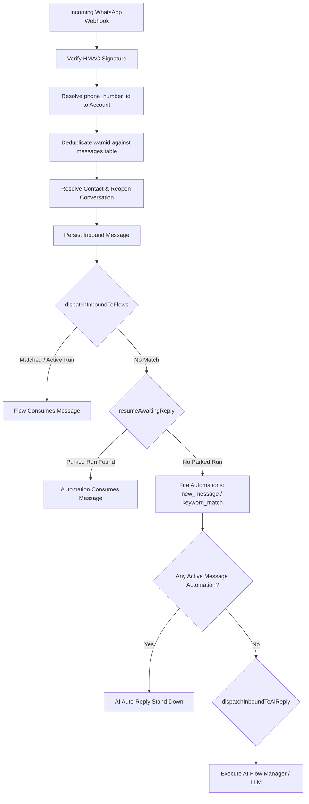
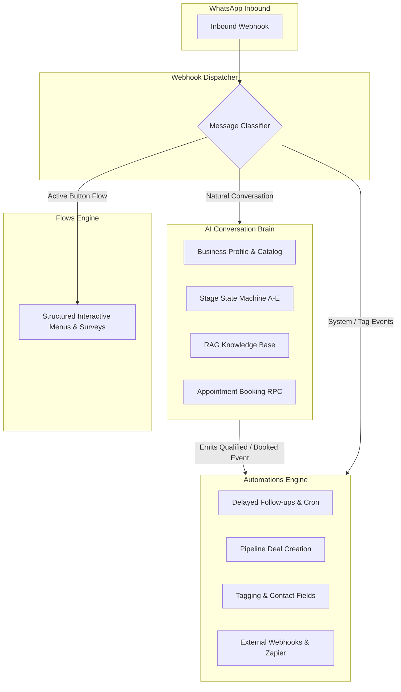

# Wattomation — Complete Architecture Audit & Best Implementation Strategy

**Document Status:** Complete Architecture Audit & Implementation Plan
**Date:** October 27, 2026
**Audited Target:** `d:/Downloads/wacrmopsiys/wacrm`
**Primary Focus Areas:** 1. Automations (`/automations`), 2. Flows (Beta) (`/flows`), 3. AI Agents (`/agents` & `/settings`)
**Audit Principles:** Code-evidence-based only; no code changes; no database/migration execution; clear distinction between verified code facts, inferences, and unverified items.

---

## Table of Contents

1. [Executive Summary](#1-executive-summary)
2. [PHASE 1 — Repository and Architecture Discovery](#2-phase-1--repository-and-architecture-discovery)
   - [1.1 Application Framework & Tech Stack](#11-application-framework--tech-stack)
   - [1.2 Navigation, Pages & Route Structure](#12-navigation-pages--route-structure)
   - [1.3 Authentication, Tenancy & Permissions](#13-authentication-tenancy--permissions)
   - [1.4 WhatsApp Webhook Inbound Pipeline & Dispatch Hierarchy](#14-whatsapp-webhook-inbound-pipeline--dispatch-hierarchy)
   - [1.5 Background Jobs, Scheduling & Queues](#15-background-jobs-scheduling--queues)
3. [PHASE 2 — Deep Audit of Automations](#3-phase-2--deep-audit-of-automations)
   - [2.1 Section Purpose & Design](#21-section-purpose--design)
   - [2.2 Quick-Start Templates Inventory](#22-quick-start-templates-inventory)
   - [2.3 Available Triggers & Activation Events](#23-available-triggers--activation-events)
   - [2.4 Step Types, Conditions, Branching & Actions](#24-step-types-conditions-branching--actions)
   - [2.5 Custom Automations & Builder Tree](#25-custom-automations--builder-tree)
   - [2.6 Storage, Validation, Lifecycle & Execution](#26-storage-validation-lifecycle--execution)
   - [2.7 Synchronous vs Scheduled Execution & Parked Runs](#27-synchronous-vs-scheduled-execution--parked-runs)
   - [2.8 Retries, Idempotency, Failure Logs & Limits](#28-retries-idempotency-failure-logs--limits)
   - [2.9 Cross-Engine Interactions](#29-cross-engine-interactions)
   - [2.10 Lead Qualifier: Deterministic vs AI Reality](#210-lead-qualifier-deterministic-vs-ai-reality)
   - [2.11 Follow-Up Reminder & 24h WhatsApp Service Window](#211-follow-up-reminder--24h-whatsapp-service-window)
   - [2.12 Implementation Status Matrix](#212-implementation-status-matrix)
4. [PHASE 3 — Deep Audit of Flows (Beta)](#4-phase-3--deep-audit-of-flows-beta)
   - [3.1 Flow System Type & Architecture](#31-flow-system-type--architecture)
   - [3.2 Supported Node Types & Configuration](#32-supported-node-types--configuration)
   - [3.3 Branching, Conditions & State Retention](#33-branching-conditions--state-retention)
   - [3.4 Flow Lifecycle & Execution State Machine](#34-flow-lifecycle--execution-state-machine)
   - [3.5 Cross-System Integration: AI, Automations & External APIs](#35-cross-system-integration-ai-automations--external-apis)
   - [3.6 Variable Interpolation & Data Passing](#36-variable-interpolation--data-passing)
   - [3.7 Runtime Engine Architecture](#37-runtime-engine-architecture)
   - [3.8 Versioning, Validation, Publishing & History](#38-versioning-validation-publishing--history)
   - [3.9 Deconstruction of the "Beta" Label](#39-deconstruction-of-the-beta-label)
   - [3.10 Industry-Specific Flow Feasibility](#310-industry-specific-flow-feasibility)
   - [3.11 Overlap with AI State Machine & Automations Engine](#311-overlap-with-ai-state-machine--automations-engine)
5. [PHASE 4 — Deep Audit of AI Agents](#5-phase-4--deep-audit-of-ai-agents)
   - [4.1 Creation, Configuration & Tenant Assignment](#41-creation-configuration--tenant-assignment)
   - [4.2 Business Profile Schema & Field Inventory](#42-business-profile-schema--field-inventory)
   - [4.3 Configurable Feature Inventory](#43-configurable-feature-inventory)
   - [4.4 Persisted vs Hardcoded Settings](#44-persisted-vs-hardcoded-settings)
   - [4.5 Runtime Loading & Dynamic Application](#45-runtime-loading--dynamic-application)
   - [4.6 Multi-Agent vs Single-Agent Architecture](#46-multi-agent-vs-single-agent-architecture)
   - [4.7 Tenancy Isolation & Shared Settings Analysis](#47-tenancy-isolation--shared-settings-analysis)
   - [4.8 Conversation State & Lead Qualification Persistence](#48-conversation-state--lead-qualification-persistence)
   - [4.9 Response Validation, Constraints & Fallback Handling](#49-response-validation-constraints--fallback-handling)
   - [4.10 AI Interaction with Automations & Flows](#410-ai-interaction-with-automations--flows)
   - [4.11 Multi-Industry Support Verification](#411-multi-industry-support-verification)
   - [4.12 AI Flow-Manager, Defaults & Templates Audit](#412-ai-flow-manager-defaults--templates-audit)
6. [PHASE 5 — Database and API Mapping](#6-phase-5--database-and-api-mapping)
   - [5.1 Comprehensive Database Schema Map](#51-comprehensive-database-schema-map)
   - [5.2 Complete API Route & Server Actions Map](#52-complete-api-route--server-actions-map)
   - [5.3 Migration Inventory & Production Verification Status](#53-migration-inventory--production-verification-status)
   - [5.4 Schema Conflicts, Redundancies & Migration Risks](#54-schema-conflicts-redundancies--migration-risks)
7. [PHASE 6 — End-to-End Execution Tracing](#7-phase-6--end-to-end-execution-tracing)
   - [Scenario A: Incoming WhatsApp Message](#scenario-a-incoming-whatsapp-message)
   - [Scenario B: First-Time Lead](#scenario-b-first-time-lead)
   - [Scenario C: Appointment Booking](#scenario-c-appointment-booking)
   - [Scenario D: Business-Specific Behavior (Real Estate vs Cleaning)](#scenario-d-business-specific-behavior-real-estate-vs-cleaning)
   - [Scenario E: Duplicate or Failed Event Handling](#scenario-e-duplicate-or-failed-event-handling)
8. [PHASE 7 — Capability and Overlap Matrix](#8-phase-7--capability-and-overlap-matrix)
9. [PHASE 8 — Architectural Evaluation & Recommendation](#9-phase-8--architectural-evaluation--recommendation)
   - [8.1 Evaluation of Option A: Extend AI Agents](#81-evaluation-of-option-a-extend-ai-agents)
   - [8.2 Evaluation of Option B: Make Flows Central Orchestrator](#82-evaluation-of-option-b-make-flows-central-orchestrator)
   - [8.3 Evaluation of Option C: Alternative Hybrid Architecture](#83-evaluation-of-option-c-alternative-hybrid-architecture)
   - [8.4 Recommended Architecture & Rationale](#84-recommended-architecture--rationale)
10. [PHASE 9 — Industry-Adaptive Configuration Strategy](#10-phase-9--industry-adaptive-configuration-strategy)
    - [9.1 Real Estate Configuration Blueprint](#91-real-estate-configuration-blueprint)
    - [9.2 Cleaning Services Configuration Blueprint](#92-cleaning-services-configuration-blueprint)
    - [9.3 Coaching & Training Configuration Blueprint](#93-coaching--training-configuration-blueprint)
    - [9.4 E-Commerce Configuration Blueprint](#94-e-commerce-configuration-blueprint)
    - [9.5 General Customer Support Blueprint](#95-general-customer-support-blueprint)
11. [PHASE 10 — Prioritized Implementation Plan](#11-phase-10--prioritized-implementation-plan)
12. [PHASE 11 — Final Deliverables, Verified Facts & Owner Decisions](#12-phase-11--final-deliverables-verified-facts--owner-decisions)
    - [12.1 Verified Facts vs Code Inferences vs Unknowns](#121-verified-facts-vs-code-inferences-vs-unknowns)
    - [12.2 Decisions Requiring Product Owner Approval](#122-decisions-requiring-product-owner-approval)
    - [12.3 The Single Best Next Implementation Task](#123-the-single-best-next-implementation-task)

---

## 1. Executive Summary

Wattomation (`/wacrm`) is a multi-tenant WhatsApp CRM SaaS built with Next.js 16 (App Router), React 19, Supabase (PostgreSQL with Row Level Security), Tailwind CSS v4, and the Meta WhatsApp Cloud API.

An exhaustive code audit of the three dashboard sections—**Automations**, **Flows (Beta)**, and **AI Agents**—reveals that all three sections have substantial, working backend implementations. However, **they currently operate as three completely separate, unintegrated engines competing for the same inbound WhatsApp message**.

### The Critical Engine Precedence Hierarchy
In `src/app/api/whatsapp/webhook/route.ts` (lines 910–1033):
1. **Flows (Beta)** runs first. If an active run exists for the contact or an entry trigger matches, the flow consumes the message (`flowConsumed = true`).
2. **Parked Automations** (`status = 'awaiting_reply'`) run second via `resumeAwaitingReply`. If an automation was waiting for an interactive reply, it consumes the message (`automationConsumed = true`).
3. **Automations Trigger Dispatch** runs third. If neither consumed the message, content-level triggers (`new_message_received`, `keyword_match`) fire.
4. **AI Auto-Reply** runs last, **BUT contains a hidden blocker**: in `src/lib/ai/auto-reply.ts` (lines 93–103), if the account has **ANY active automation** with `trigger_type IN ('new_message_received', 'keyword_match')`, **the AI Agent stands down completely** to prevent double-replying. Even if the automation's keyword didn't match the current message, the mere existence of an active keyword or message automation completely silences the AI Agent for the entire account!

### Core Finding by Section
- **Automations (`/automations`):** Fully operational, tree-based workflow engine. Supports 8 triggers and 13 step types (including WhatsApp interactive buttons/lists, pre-approved Meta templates, deal creation, tags, SSRF-guarded webhooks, and delayed execution via cron). Templates are 100% deterministic (the "Lead Qualifier" template does not use AI; it sends a static text, waits 10 minutes, and round-robins conversation assignment).
- **Flows (Beta) (`/flows`):** A visual React Flow (`@xyflow/react`) directed acyclic graph (DAG) builder and stateful runtime engine (`src/lib/flows/engine.ts`). It supports 10 node types (`start`, `send_message`, `send_buttons`, `send_list`, `send_media`, `collect_input`, `condition`, `set_tag`, `handoff`, `end`). It maintains state across messages in `flow_runs(vars)`. However, it has **no AI nodes**, **no delay nodes**, **no external HTTP/API fetch** (`http_fetch` was deferred to v2), and **no appointment scheduling**.
- **AI Agents (`/agents` & `/settings`):** Configured via `ai_configs` (one agent per account). Uses a deterministic flow manager (`src/lib/ai/flow-manager.ts`) managing conversation stages (A: Understand, B: Acknowledge & Benefits, C: Pricing, D: Consultation & Calendar Booking, E: Completed). It has natural-language date/time parsing, atomic meeting booking with PostgreSQL exclusion locks (`book_meeting_atomically`), RAG knowledge base search with pgvector embeddings, and tenant business profile settings (`business_profile`, `conversation_flow`, `message_templates`).

### Recommended Architectural Path
**Option A with Hybrid Orchestration:** Maintain the **AI Agent as the primary conversational and business configuration brain** (handling natural dialogue, qualification, catalog pricing, and calendar scheduling), while transforming **Automations** into the event-driven action runner (deal creation, webhooks, tags, delayed re-engagement) and using **Flows** exclusively for structured, deterministic button/list survey menus. Fix the dispatch conflict in the webhook and bridge the AI Agent to Automations.

---

## 2. PHASE 1 — Repository and Architecture Discovery

### 1.1 Application Framework & Tech Stack
- **Framework:** Next.js 16.3.8 (App Router), React 19.2.4, Node.js `>=22.12.0`.
- **Language:** TypeScript 6 (`strict: true`).
- **Database & Auth:** Supabase (`@supabase/supabase-js` 2.118.0, `@supabase/ssr` 0.12.7). PostgreSQL 15+ with pgvector, btree_gist, and RLS.
- **Visual Graphs:** `@xyflow/react` 12.12.0 (React Flow) and `@dagrejs/dagre` 3.1.1.
- **Styling:** Tailwind CSS v4 (`@tailwindcss/postcss` 4), `tw-animate-css`, `lucide-react`.
- **I18n:** `next-intl` 4.14.9 with complete localization files in `messages/`.
- **Testing:** Vitest 5.0.5 (`vitest run`).

### 1.2 Navigation, Pages & Route Structure
The dashboard navigation is defined in `src/app/(dashboard)/dashboard-shell.tsx` and partitioned into functional groups:
- **Core Operations:** `/inbox` (WhatsApp conversation manager), `/contacts` (Contact book), `/broadcasts` (Campaign broadcasts), `/pipelines` (CRM deals & stages), `/meetings` (Scheduled appointments).
- **Automation & Intelligence:**
  - `/automations` (`src/app/(dashboard)/automations/page.tsx`, `new/page.tsx`, `[id]/edit/page.tsx`, `[id]/logs/page.tsx`)
  - `/flows` (`src/app/(dashboard)/flows/page.tsx`, `[id]/page.tsx`, `[id]/runs/page.tsx`)
  - `/agents` (`src/app/(dashboard)/agents/page.tsx` — tabs: Playground, Setup, Usage)
- **Account & System:** `/settings` (WhatsApp config, templates, tags, API keys, AI settings), `/admin` (Platform-wide tenant administration), `/billing` (SaaS plans & usage quotas).

### 1.3 Authentication, Tenancy & Permissions
- **Multi-Tenancy Model:** Pure account-based workspace isolation (`accounts` table, migration `017_account_sharing.sql` and `051_tenant_isolation_and_schema_hardening.sql`).
- **Profile Linkage:** `profiles.account_id` links `auth.users` to an `accounts` row.
- **Role Hierarchy:** Defined in `src/lib/auth/roles.ts`:
  - `owner` (Rank 4): Ownership transfer, account deletion, billing, admin management.
  - `admin` (Rank 3): Member invitations, settings modification, WhatsApp credentials, AI configuration.
  - `agent` (Rank 2): Operational read/write — send messages, edit deals, create automations, manage contacts.
  - `viewer` (Rank 1): Read-only access across all dashboard sections.
- **API Tenancy Resolution:**
  - Dashboard routes call `getCurrentAccount()` / `requireRole(min)` in `src/lib/auth/account.ts`, reading the authenticated Supabase session cookie and enforcing minimum roles and account approval status (`approval_status`).
  - Public API routes (`/api/v1/*`) call `requireApiKey(request, scope)` in `src/lib/auth/api-context.ts`, matching the hashed bearer token in `api_keys.key_hash` to resolve the `accountId`.

### 1.4 WhatsApp Webhook Inbound Pipeline & Dispatch Hierarchy
Located in `src/app/api/whatsapp/webhook/route.ts`:
- **Verification:** `GET` handles Meta's webhook challenge using `verifyTokenMatches`. `POST` verifies the HMAC-SHA256 signature against `WHATSAPP_APP_SECRET` using `verifyMetaWebhookSignature` (`src/lib/whatsapp/webhook-signature.ts`).
- **Deduplication:** Checks incoming `wamid` against `messages.message_id`. If already inserted, ignores duplicate.
- **Account Resolution:** Incoming `phone_number_id` is queried against `whatsapp_config.phone_number_id` (migration `013_whatsapp_config_phone_number_id_unique.sql`) to resolve `account_id` and the config owner's `user_id`.
- **Identity & Contact Resolution:** `resolveInboundIdentity` (`src/lib/whatsapp/wa-identity.ts`) parses phone number or Meta BSUID (`from_user_id`). `findExistingContact` (`src/lib/contacts/dedupe.ts`) matches by phone or `wa_user_id`. Auto-creates contact if absent (`contactOutcome.wasCreated = true`).
- **Conversation State:** Opens or finds existing conversation. Calls `reopenClosedConversation` (`src/lib/conversations/reopen.ts`) if status was closed.
- **Message Persistence:** Saves inbound message to `messages` table (`sender_type = 'contact'`).
- **Post-Processing Pipeline (`after()` block, lines 910–1048):**
  1. `dispatchInboundToFlows`: Executes first. If a flow consumes the message, `flowConsumed = true`.
  2. `resumeAwaitingReply`: Executes second. Checks if contact was parked at an interactive reply step in `automation_pending_executions`. If matched, `automationConsumed = true`.
  3. Content-level triggers (`new_message_received`, `keyword_match`, `interactive_reply`) fire ONLY IF `!contentConsumed`.
  4. Relationship-level triggers (`new_contact_created`, `first_inbound_message`) fire regardless of whether content was consumed.
  5. `dispatchInboundToAiReply`: Fires ONLY IF `!contentConsumed && !interactiveReplyId && inboundText.trim()`.



### 1.5 Background Jobs, Scheduling & Queues
- **Automations Cron:** `/api/automations/cron/route.ts` drains `automation_pending_executions` rows where `status = 'pending' AND run_at <= now()`. Also settles expired `awaiting_reply` rows older than 24h via `expireAwaitingReplies()`.
- **Flows Cron:** `/api/flows/cron/route.ts` sweeps stale `flow_runs` exceeding `fallback_policy.on_timeout_hours` and marks them `timed_out`.
- **External Triggering:** Documented in `docs/external-cron.md`. Protected by `AUTHENTICATE_CRON_REQUEST` verifying `x-cron-secret` or `Authorization: Bearer <AUTOMATION_CRON_SECRET>`.

---

## 3. PHASE 2 — Deep Audit of Automations

### 2.1 Section Purpose & Design
The Automations section (`/automations`) is designed as an event-driven automation system for WhatsApp interactions and CRM housekeeping. It executes sequences of actions in response to incoming events (messages, keywords, tags, new contacts, conversation assignments).

### 2.2 Quick-Start Templates Inventory
Defined in `src/lib/automations/templates.ts` (lines 42–136):
1. **Welcome Message (`welcome_message`):**
   - *Trigger:* `first_inbound_message` (empty config).
   - *Steps:* `send_message` (localized welcome text) &rarr; `add_tag` (tag_id placeholder).
2. **Out of Office (`out_of_office`):**
   - *Trigger:* `new_message_received`.
   - *Steps:* `condition` (subject: `time_of_day`, operand: `18:00-09:00`) &rarr; branch `yes`: `send_message` (localized out-of-office message).
3. **Lead Qualifier (`lead_qualifier`):**
   - *Trigger:* `keyword_match` (match_type: `contains`, keywords from translations).
   - *Steps:* `send_message` (qualification inquiry) &rarr; `wait` (10 minutes) &rarr; `assign_conversation` (mode: `round_robin`).
   - *Evidence:* This template is **100% deterministic**. It does NOT qualify via AI, does NOT extract lead entities, and does NOT assess lead intent.
4. **Follow-up Reminder (`follow_up_reminder`):**
   - *Trigger:* `new_message_received`.
   - *Steps:* `wait` (amount: 1, unit: `days`) &rarr; `send_message` (localized reminder text).

### 2.3 Available Triggers & Activation Events
Defined in `src/types/index.ts` (lines 477–514) and validated in `src/lib/automations/trigger-meta.ts`:
1. `new_message_received`: Fires on every inbound message unless consumed by a Flow or parked automation.
2. `first_inbound_message`: Fires when an inbound message is the contact's first-ever message.
3. `keyword_match`: Evaluates message text against configured keywords. Supports `match_type: 'contains' | 'exact' | 'word'` (via Unicode-aware lookarounds `matchesWholeWord` in `engine.ts` lines 983–997) and `case_sensitive: boolean`.
4. `new_contact_created`: Fires when a webhook auto-creates a new `contacts` record.
5. `conversation_assigned`: Fires when an agent is assigned to a conversation.
6. `tag_added`: Fires when a tag is attached to a contact (enforces `MAX_TAG_CHAIN_DEPTH = 5` in `src/lib/contacts/tag-chain.ts` to prevent infinite cascading loops).
7. `time_based`: Defined in types; scheduled time-based triggers.
8. `interactive_reply`: Matches tapped button ID or list row ID against `trigger_config.reply_ids`.

### 2.4 Step Types, Conditions, Branching & Actions
Defined in `src/types/index.ts` (lines 538–650) and implemented in `src/lib/automations/engine.ts` (lines 650–914):
- **Messaging Actions:**
  - `send_message`: Sends plain text WhatsApp message via Meta Graph API (`engineSendText`). Supports interpolation: `{{ message.text }}`, `{{ vars.<key> }}`.
  - `send_buttons`: Sends interactive reply buttons (1–3 buttons). Optional `wait_for_reply: true` parks execution.
  - `send_list`: Sends interactive section list (up to 10 rows). Optional `wait_for_reply: true` parks execution.
  - `send_template`: Sends Meta pre-approved template message (`engineSendTemplate`). Variables are numerically sorted (`{{1}}`, `{{2}}`, ...) to prevent lexicographic scrambling (`1`, `10`, `2`).
- **Contact & CRM Actions:**
  - `add_tag`: Adds tag via `addContactTagIfAbsent`. Cascades to `tag_added` trigger if under max depth.
  - `remove_tag`: Removes tag from contact.
  - `assign_conversation`: Assigns conversation to specific agent or round-robin across account agents.
  - `update_contact_field`: Updates core contact columns or JSONB custom fields.
  - `create_deal`: Inserts row into `deals` table with title interpolation and account `default_currency`.
  - `close_conversation`: Sets `conversations.status = 'closed'`.
- **Workflow Control & Integration:**
  - `wait`: Suspends execution for specified duration (`minutes`, `hours`, `days`). Inserts row into `automation_pending_executions`.
  - `condition`: Evaluates condition subject and branches into `yes` (true) or `no` (false). Supported subjects:
    - `tag_presence`: Checks `contact_tags` for specified `tag_id`.
    - `contact_field`: Compares contact attribute against `cfg.value`.
    - `message_content`: Case-insensitive substring match on incoming message.
    - `time_of_day`: Parses `HH:mm-HH:mm` (handles midnight wraps like `18:00-09:00`).
  - `send_webhook`: Outbound HTTP POST with JSON body. Protected by `isDeliverableUrl` SSRF guard (refuses private, loopback, link-local IPs), rejects HTTP redirects (`redirect: 'manual'`), and enforces a 10s timeout (`AbortSignal.timeout(10_000)`).

### 2.5 Custom Automations & Builder Tree
Users can build custom automations from scratch via the builder at `/automations/new` and `/automations/[id]/edit` (`src/components/automations/automation-builder.tsx`). The builder provides a visual, drag-and-drop tree interface (`src/lib/automations/builder-tree.ts`) supporting arbitrarily nested conditional branches.

### 2.6 Storage, Validation, Lifecycle & Execution
- **Storage:** Persisted in `automations` and `automation_steps` tables (`supabase/migrations/006_automations.sql`).
- **Validation:** Server-side validation in `src/lib/automations/validate.ts` enforces step-specific required fields, interactive button limits (1–3 buttons, title ≤ 20 chars), and template variable bounds before saving.
- **Lifecycle:** Toggled active/inactive via `PATCH /api/automations/[id]` (`is_active: boolean`). Duplicated via `POST /api/automations/[id]/duplicate`.

### 2.7 Synchronous vs Scheduled Execution & Parked Runs
- **Synchronous Entry:** Executed inside the webhook's `after()` block in Next.js via `runAutomationsForTrigger`.
- **Parked Execution (`wait`):** When encountering a `wait` step, the runner inserts a row into `automation_pending_executions` with `status = 'pending'` and `run_at = now + ms`, then halts the current scope. The external cron endpoint `/api/automations/cron` queries due rows and resumes them via `resumePendingExecution()`.
- **Parked for Reply (`wait_for_reply`):** Interactive sends with `wait_for_reply: true` insert a row into `automation_pending_executions` with `status = 'awaiting_reply'` and `run_at = now + 24h`. When the customer replies, `resumeAwaitingReply()` claims the row (`status = 'running'`) and continues execution from the next step.

### 2.8 Retries, Idempotency, Failure Logs & Limits
- **Execution Logs:** Persisted in `automation_logs`. Each run inserts a log row with `steps_executed: []`. The status is initialized to `failed` and only updated to `success` if execution completes without unhandled errors (pessimistic logging, issue #409).
- **Execution Counter:** Incremented atomically via PostgreSQL function `increment_automation_execution_count` (migration `007_automations_increment_counter.sql`).
- **No Automatic Retry:** Failed steps log an error message to `automation_logs` and abort execution; there is no exponential backoff or retry queue for failed webhook steps or Meta send failures.

### 2.9 Cross-Engine Interactions
- Automations **cannot invoke Flows**.
- Automations **cannot call the AI Agent**.
- As documented in Section 1.4, **active automations with `new_message_received` or `keyword_match` silence the AI Agent**.

### 2.10 Lead Qualifier: Deterministic vs AI Reality
The "Lead Qualifier" quick-start template is purely deterministic:
```typescript
// src/lib/automations/templates.ts (lines 91-116)
lead_qualifier: {
  trigger_type: 'keyword_match',
  steps: [
    { step_type: 'send_message', step_config: { text: '...' } },
    { step_type: 'wait', step_config: { amount: 10, unit: 'minutes' } },
    { step_type: 'assign_conversation', step_config: { mode: 'round_robin' } }
  ]
}
```
There is zero AI conversation, zero entity extraction, and zero requirement gathering in this template.

### 2.11 Follow-Up Reminder & 24h WhatsApp Service Window
The "Follow-up Reminder" template contains a critical architectural flaw regarding WhatsApp messaging policies:
1. It waits 1 day (`wait 1 days`) and then executes `send_message` (plain text).
2. WhatsApp Meta Cloud API strictly enforces the **24-hour Customer Service Window**. Once 24 hours have elapsed since the customer's last inbound message, Meta **rejects all free-form text messages** with error code 131047 / subcode 470 ("Re-engagement message outside 24h window").
3. Outside the 24-hour window, WhatsApp **requires a pre-approved Meta Template message (`send_template`)**.
4. The template does NOT check if the customer replied during the 24-hour wait, nor does it use a pre-approved template message. Consequently, standard execution of this template will fail at Meta with a 400 error unless the customer messaged again in the interim.

### 2.12 Implementation Status Matrix
| Feature | UI Status | Backend Status | Operational Reality |
| :--- | :--- | :--- | :--- |
| Welcome Message Template | Complete | Complete | Fully operational |
| Out of Office Template | Complete | Complete | Fully operational |
| Lead Qualifier Template | Complete | Complete | Fully operational (Deterministic only; No AI) |
| Follow-up Reminder Template | Complete | Partial | Fails at Meta outside 24h window due to plain text |
| Custom Automation Builder | Complete | Complete | Fully operational (nested tree branching) |
| Interactive Buttons / Lists | Complete | Complete | Fully operational (with 24h reply parking) |
| Webhook Step (SSRF Protected)| Complete | Complete | Fully operational |
| Deal Creation Step | Complete | Complete | Fully operational (uses account default currency) |
| Cron Resumption | N/A (API) | Complete | Operational via external cron runner |

---

## 4. PHASE 3 — Deep Audit of Flows (Beta)

### 4.1 Flow System Type & Architecture
Flows (`/flows`) is a **visual conversational graph builder and stateful runtime engine**. It is built on:
- **Visual Canvas:** React Flow (`@xyflow/react` v12.12.0) and Dagre (`@dagrejs/dagre` v3.1.1) in [flow-canvas.tsx](file:///d:/Downloads/wacrmopsiys/wacrm/src/components/flows/flow-canvas.tsx).
- **Editor Shell & State:** [flow-editor-shell.tsx](file:///d:/Downloads/wacrmopsiys/wacrm/src/components/flows/flow-editor-shell.tsx) and [flow-editor-state.tsx](file:///d:/Downloads/wacrmopsiys/wacrm/src/components/flows/flow-editor-state.tsx), providing live switching between **Canvas** and **List** views, node-type legend, drag-to-connect handles, minimap, and active validation panel.
- **Runtime Execution Engine:** Custom synchronous and stateful graph walker in [engine.ts](file:///d:/Downloads/wacrmopsiys/wacrm/src/lib/flows/engine.ts).
- **Database Schema:** Tables `flows`, `flow_nodes`, `flow_runs`, and `flow_run_events` (migration `010_flows.sql`, `012_flows_increment_counter.sql`, `016_flow_media.sql`, and `017_account_sharing.sql`).

### 4.2 Exact Analysis of the "Welcome Menu" Implementation (Screenshot Evidence)
The user's active flow visibly displayed in the dashboard is the starter template `welcome_menu` ([templates.ts:L84-L133](file:///d:/Downloads/wacrmopsiys/wacrm/src/lib/flows/templates.ts#L84-L133)):
1. **Header Elements:**
   - **Title & Status:** "Welcome menu" with `status = 'active'` green badge.
   - **Runs Counter:** Displays "Runs 8". This represents `flows.execution_count`, incremented atomically via the PostgreSQL RPC `increment_flow_execution_count` (migration `012_flows_increment_counter.sql`) each time a new run is initialized for a contact.
   - **Action Controls:** *Canvas/List* segmented view toggle, *Runs* (links to `/flows/[id]/runs`), *Delete*, *Pause* (`PATCH status='draft'`), and *Save* (`PUT /api/flows/[id]`).
2. **Graph Topology in the Canvas:**
   - **Node 1 (`start`):** Entry node (`node_key: 'start'`). Displays "ENTRY" badge. Config contains `{ next_node_key: 'welcome' }`.
   - **Node 2 (`send_buttons`):** Node key `welcome`. Renders prompt: *"Hi 👋 Welcome to support. Are you an e..."* with footer *"Existing customer / New customer"*. Contains two buttons:
     - Button 1: Label *"Existing customer"*, `reply_id: 'existing'`, `next_node_key: 'existing_handoff'`.
     - Button 2: Label *"New customer"*, `reply_id: 'new'`, `next_node_key: 'new_handoff'`.
   - **Node 3 (`handoff`):** Node key `new_handoff`. Displays note: *"New customer — share pricing + onboarding link"*. Connected via handle `button:new` from Node 2.
   - **Node 4 (`handoff`):** Node key `existing_handoff`. Displays note: *"Existing customer needs assistance — please check account history before..."*. Connected via handle `button:existing` from Node 2.
3. **Validation Panel:** Displays bottom green bar: *"No issues. Ready to activate."*, rendered by [validation-panel.tsx](file:///d:/Downloads/wacrmopsiys/wacrm/src/components/flows/validation-panel.tsx) from [validate.ts](file:///d:/Downloads/wacrmopsiys/wacrm/src/lib/flows/validate.ts).

### 4.3 Node Runtime Verification (Every Visible Node Type)
Every node category exposed in the builder's top legend has been verified against the runtime engine in [src/lib/flows/engine.ts](file:///d:/Downloads/wacrmopsiys/wacrm/src/lib/flows/engine.ts):

| Visible Node Type | Editor UI & Form | Runtime Engine Status | Engine Implementation Evidence | Runtime Behavior & Limitations |
| :--- | :--- | :--- | :--- | :--- |
| **Start** | [shared.tsx:L32](file:///d:/Downloads/wacrmopsiys/wacrm/src/components/flows/shared.tsx#L32) | **Fully Working** | [engine.ts:L639-L642](file:///d:/Downloads/wacrmopsiys/wacrm/src/lib/flows/engine.ts#L639-L642) | Auto-advances to `cfg.next_node_key`. Entry point for all runs. |
| **Send Message** | [node-config-form.tsx:L28](file:///d:/Downloads/wacrmopsiys/wacrm/src/components/flows/forms/node-config-form.tsx#L28) | **Fully Working** | [engine.ts:L643-L667](file:///d:/Downloads/wacrmopsiys/wacrm/src/lib/flows/engine.ts#L643-L667) | Calls `engineSendText` via Meta API. Interpolates `{{vars.X}}`. Auto-advances. |
| **Send Buttons** | [node-config-form.tsx:L82](file:///d:/Downloads/wacrmopsiys/wacrm/src/components/flows/forms/node-config-form.tsx#L82) | **Fully Working** | [engine.ts:L802-L833](file:///d:/Downloads/wacrmopsiys/wacrm/src/lib/flows/engine.ts#L802-L833) | Sends 1–3 interactive buttons via Meta. Updates `flow_runs.current_node_key` and **suspends run** awaiting customer tap. |
| **Send List** | [node-config-form.tsx:L168](file:///d:/Downloads/wacrmopsiys/wacrm/src/components/flows/forms/node-config-form.tsx#L168) | **Fully Working** | [engine.ts:L834-L857](file:///d:/Downloads/wacrmopsiys/wacrm/src/lib/flows/engine.ts#L834-L857) | Sends sectioned list (up to 10 rows). Updates `current_node_key` and **suspends run** awaiting customer selection. |
| **Send Media** | [node-config-form.tsx:L247](file:///d:/Downloads/wacrmopsiys/wacrm/src/components/flows/forms/node-config-form.tsx#L247) | **Fully Working** | [engine.ts:L668-L698](file:///d:/Downloads/wacrmopsiys/wacrm/src/lib/flows/engine.ts#L668-L698) | Uploads image/video/document to `flow-media` bucket and sends via Meta API. Auto-advances. |
| **Collect Input** | [node-config-form.tsx:L316](file:///d:/Downloads/wacrmopsiys/wacrm/src/components/flows/forms/node-config-form.tsx#L316) | **Partially Working** | [engine.ts:L699-L746](file:///d:/Downloads/wacrmopsiys/wacrm/src/lib/flows/engine.ts#L699-L746) | Sends prompt and suspends. Next customer text captures into `flow_runs.vars[var_key]`. **Caveat:** Validation rules (`email`, `phone`, `regex`) are ignored by runner; any non-empty text is accepted ([types.ts:L130](file:///d:/Downloads/wacrmopsiys/wacrm/src/lib/flows/types.ts#L130)). |
| **If / Else (Condition)**| [node-config-form.tsx:L390](file:///d:/Downloads/wacrmopsiys/wacrm/src/components/flows/forms/node-config-form.tsx#L390) | **Fully Working** | [engine.ts:L747-L769](file:///d:/Downloads/wacrmopsiys/wacrm/src/lib/flows/engine.ts#L747-L769) | Evaluates predicate (`equals`, `contains`, `present`, `absent`) on `var`, `tag`, or `contact_field`. Auto-advances to `true_next` or `false_next`. |
| **Tag Contact (Set Tag)**| [node-config-form.tsx:L473](file:///d:/Downloads/wacrmopsiys/wacrm/src/components/flows/forms/node-config-form.tsx#L473) | **Fully Working** | [engine.ts:L770-L801](file:///d:/Downloads/wacrmopsiys/wacrm/src/lib/flows/engine.ts#L770-L801) | Adds/removes tag via `addContactTagAndDispatch`. Auto-advances. |
| **Handoff to Agent** | [node-config-form.tsx:L514](file:///d:/Downloads/wacrmopsiys/wacrm/src/components/flows/forms/node-config-form.tsx#L514) | **Fully Working** | [engine.ts:L479-L501](file:///d:/Downloads/wacrmopsiys/wacrm/src/lib/flows/engine.ts#L479-L501) | **Human handoff only.** Sets `conversations.status = 'pending'`, sets `assigned_agent_id = cfg.assign_to`, and ends run (`status = 'handed_off'`). **Does not invoke AI.** |
| **End** | [node-config-form.tsx:L545](file:///d:/Downloads/wacrmopsiys/wacrm/src/components/flows/forms/node-config-form.tsx#L545) | **Fully Working** | [engine.ts:L862-L866](file:///d:/Downloads/wacrmopsiys/wacrm/src/lib/flows/engine.ts#L862-L866) | Terminal node. Marks run `status = 'completed'` with reason `end_node`. |

**Node Types Absent from the Builder:**
- `ai_step` / `ai_agent`: **Missing.** Flows cannot call an LLM or AI Agent.
- `http_fetch` / `api_call`: **Missing.** Planned for v2 ([engine.ts:L510](file:///d:/Downloads/wacrmopsiys/wacrm/src/lib/flows/engine.ts#L510)).
- `wait` / `delay`: **Missing.** Flows cannot delay execution (unlike Automations).
- `create_deal`: **Missing.** Flows cannot create CRM pipeline deals.
- `book_meeting`: **Missing.** Flows cannot schedule calendar meetings.

### 4.4 Canvas Connections, Branching, Validation & Persistence
1. **Edge Storage Mechanism:**
   - There is **no separate edges table** in the database.
   - Edges are embedded **inside each node's `config` JSONB column**:
     - Single-outgoing nodes (`start`, `send_message`, `send_media`, `collect_input`, `set_tag`) carry `config.next_node_key`.
     - `send_buttons` carries `config.buttons[i].next_node_key`.
     - `send_list` carries `config.sections[i].rows[j].next_node_key`.
     - `condition` carries `config.true_next` and `config.false_next`.
   - In [edges.ts](file:///d:/Downloads/wacrmopsiys/wacrm/src/lib/flows/edges.ts#L40-L140), `deriveCanvasEdges` parses the nodes array in memory and produces React-Flow edge objects `{ id, source, target, sourceHandle, label }`.
   - Connecting an edge on the canvas calls `connectEdge()` in `edges.ts`, which mutates the source node's JSONB config.
2. **Validation Engine:**
   - Defined in [validate.ts](file:///d:/Downloads/wacrmopsiys/wacrm/src/lib/flows/validate.ts). Checks:
     - Flow has a valid name and active trigger.
     - Graph contains exactly one `start` node.
     - All `next_node_key`, `true_next`, and `false_next` references point to existing nodes.
     - No unreachable/orphan nodes exist.
     - Interactive button counts (1–3) and titles (≤ 20 characters per Meta limit).
   - If invalid, the bottom panel flags errors and disables activation.
3. **Persistence Mechanism:**
   - Saving in [header.tsx](file:///d:/Downloads/wacrmopsiys/wacrm/src/components/flows/header.tsx#L55-L95) sends `PUT /api/flows/[id]`.
   - In [api/flows/[id]/route.ts](file:///d:/Downloads/wacrmopsiys/wacrm/src/app/api/flows/%5Bid%5D/route.ts#L75-L165), it updates `flows` metadata, deletes obsolete `flow_nodes`, and upserts all nodes with their updated JSONB configs and canvas coordinates `(position_x, position_y)`.

### 4.5 Inbound Triggering & Execution State Persistence
1. **Trigger Dispatch:**
   - In [webhook/route.ts:L910](file:///d:/Downloads/wacrmopsiys/wacrm/src/app/api/whatsapp/webhook/route.ts#L910), `dispatchInboundToFlows` is the very first runner invoked.
   - It queries `flow_runs` for an existing active run:
     ```typescript
     // engine.ts: lines 203-225
     SELECT * FROM flow_runs WHERE account_id = $1 AND contact_id = $2 AND status = 'active'
     ```
   - If an active run exists:
     - If the customer tapped a button: matches `reply_id` via `matchReplyId()`.
     - If the customer replied with text: if current node is `collect_input`, stores text in `flow_runs.vars[var_key]`.
     - Advances the graph. Returns `consumed: true`, which **suppresses Automations and AI Auto-Reply**.
   - If no active run exists:
     - Queries active flows where `status = 'active'`.
     - Evaluates `flow.trigger_type`:
       - `keyword`: matches text against keywords (`exact` or `contains`).
       - `first_inbound_message`: matches if contact has never messaged before.
     - If matched, starts new run via `startNewRun()`, inserts `flow_runs` row, increments `flows.execution_count`, runs the advance loop, and returns `consumed: true`.
2. **State Retention Across Messages:**
   - State is persisted in `flow_runs`:
     - `current_node_key`: Points to the suspending node where execution paused.
     - `vars`: JSONB object holding all captured variables (`{{vars.key}}`).
     - `reprompt_count`: Counter for invalid replies.
     - `last_prompt_message_id`: WhatsApp message ID of the bot's prompt.
   - Partial unique index `idx_one_active_run_per_contact` on `flow_runs(account_id, contact_id) WHERE status = 'active'` guarantees that a contact can never have multiple concurrent active flow runs.

### 4.6 What "Handoff to Agent" Actually Does
The Handoff node (`handoff`) in [src/lib/flows/engine.ts](file:///d:/Downloads/wacrmopsiys/wacrm/src/lib/flows/engine.ts#L479-L501) performs the following exact database writes:
1. `conversations.status = 'pending'`.
2. `conversations.assigned_agent_id = cfg.assign_to` (if a specific agent user UUID was selected).
3. Inserts an event into `flow_run_events` with `event_type = 'handoff'`, recording the author's internal handoff note (`cfg.note`) and assigned user ID.
4. Updates `flow_runs.status = 'handed_off'` and `flow_runs.end_reason = 'handoff_node'`.
5. **Critical Finding:** **"Handoff to Agent" hands off ONLY to human agents in the inbox.** It does **NOT** invoke an AI Agent. Furthermore, assigning an agent in `conversations.assigned_agent_id` explicitly causes the AI auto-reply bot to stand down ([auto-reply.ts:L114-L117](file:///d:/Downloads/wacrmopsiys/wacrm/src/lib/ai/auto-reply.ts#L114-L117)), locking the conversation in human-only mode.

### 4.7 Access to AI Business Profiles, Prompts, Pricing & Templates
- Flows has **zero access** to `ai_configs`.
- Flows cannot read `ai_configs.business_profile` (business name, services catalog, pricing packages, FAQs).
- Flows cannot access `ai_configs.message_templates`.
- Flows cannot access `ai_configs.system_prompt`.
- Any text, button label, or handoff note in a flow must be manually typed into the node editor.

### 4.8 Capability Verification: AI, Business Data, Leads, Meetings & Automations
- **Invoke AI:** **No.** Flows cannot call OpenAI, Anthropic, or the local AI Flow Manager.
- **Query Business Data:** **No.** Flows cannot query databases, inventory, or product catalogs.
- **Create/Update Leads:** **Partial.** Flows can capture text into `flow_runs.vars`, update standard contact fields (`name`, `email`, `phone`, `company`) via condition nodes, and set tags via `set_tag`. However, it does not write to `ai_lead_qualifications` and cannot calculate lead scores.
- **Book Meetings:** **No.** Flows has no calendar integration and cannot call `book_meeting_atomically`.
- **Trigger Automations:** **Indirectly via Tags only.** When a flow executes a `set_tag` node with `mode: 'add'`, [engine.ts:L774](file:///d:/Downloads/wacrmopsiys/wacrm/src/lib/flows/engine.ts#L774) calls `addContactTagAndDispatch`, which fires the `tag_added` trigger in the Automations engine. Other than tags, flows cannot trigger automations.

### 4.9 Runs Counter, History, Retries & Failures
1. **Runs Counter:**
   - Displayed as `Runs <count>` in the editor header ([header.tsx:L108](file:///d:/Downloads/wacrmopsiys/wacrm/src/components/flows/header.tsx#L108)).
   - Represents the total lifetime runs started by this flow. It is incremented atomically via `db.rpc('increment_flow_execution_count', { p_flow_id: flow.id })` in [engine.ts:L1198](file:///d:/Downloads/wacrmopsiys/wacrm/src/lib/flows/engine.ts#L1198).
2. **Execution History:**
   - Navigated via the Runs button to `/flows/[id]/runs` ([api/flows/[id]/runs/route.ts](file:///d:/Downloads/wacrmopsiys/wacrm/src/app/api/flows/%5Bid%5D/runs/route.ts)).
   - Displays the 50 most recent runs from `flow_runs`, including contact name/phone, started at, ended at, end reason, and step-by-step event timeline from `flow_run_events` (`started`, `node_entered`, `message_sent`, `reply_received`, `fallback_fired`, `handoff`, `timeout`, `error`, `completed`).
3. **Retries:**
   - Retries in Flows are **reprompts on unknown replies** governed by `flows.fallback_policy` ([fallback.ts](file:///d:/Downloads/wacrmopsiys/wacrm/src/lib/flows/fallback.ts)).
   - If a customer types text that does not match any button or list option, `flow_runs.reprompt_count` increments. If `reprompt_count <= max_reprompts` (default: 2), the engine re-sends the prompt. Once exhausted, it executes `on_exhaust` (`'handoff'` or `'end'`).
4. **Failures:**
   - When a node fails (e.g. Meta API rejection, length violation, missing node key), [engine.ts:L658](file:///d:/Downloads/wacrmopsiys/wacrm/src/lib/flows/engine.ts#L658) logs an `error` event to `flow_run_events` and marks the run `status = 'failed'` with `end_reason = '<error_reason>'`. There are no automated network retries for failed Meta sends.

### 4.10 Comparison: Flow Engine vs AI Conversation Flow Manager
The codebase contains **two completely separate flow systems**:

| System | Primary Code Files | State Storage | Paradigm | Strengths | Weaknesses |
| :--- | :--- | :--- | :--- | :--- | :--- |
| **Flow Engine (Flows Beta)** | [src/lib/flows/engine.ts](file:///d:/Downloads/wacrmopsiys/wacrm/src/lib/flows/engine.ts) | `flow_runs`, `flow_run_events` | Visual Directed Graph (DAG) | Structured button menus, strict routing, visual drag-and-drop, zero hallucinations | Rigid; cannot understand natural text; no AI; no calendar booking |
| **AI Flow Manager (AI Agents)**| [src/lib/ai/flow-manager.ts](file:///d:/Downloads/wacrmopsiys/wacrm/src/lib/ai/flow-manager.ts) | `ai_lead_qualifications` (`flow_state`) | Stage State Machine (Stages A–E) | Natural language dialogue, dynamic service matching, RAG knowledge retrieval, NLP datetime & calendar booking | Non-visual; code-defined state machine; requires BYO AI key |

**How They Overlap & Conflict:**
- Both attempt to be the primary greeter and qualifier for inbound WhatsApp contacts.
- In [webhook/route.ts:L910-L1015](file:///d:/Downloads/wacrmopsiys/wacrm/src/app/api/whatsapp/webhook/route.ts#L910-L1015), **Flows wins unconditionally**. If a contact matches a flow or is in an active flow run, the AI Flow Manager is completely bypassed.

### 4.11 Reusable Industry-Specific Workflows via Flows
**Can the existing visual builder support reusable industry-specific workflows through configuration?**
- **YES, for structured, deterministic triage trees:**
  - *Real Estate Intake:* Start &rarr; Send Buttons (*"Buy / Rent / Sell"*) &rarr; Send List (*"Price Range"*) &rarr; Collect Input (*"Preferred Location"*) &rarr; Handoff to Agent with variables in note.
  - *Cleaning Intake:* Start &rarr; Send Buttons (*"Home / Office"*) &rarr; Collect Input (*"Bedrooms"*) &rarr; If/Else (*"Bedrooms > 3"*) &rarr; Tag Contact (*"Large Property"*) &rarr; Handoff to Agent.
  - These can be packaged as templates in [src/lib/flows/templates.ts](file:///d:/Downloads/wacrmopsiys/wacrm/src/lib/flows/templates.ts) without creating any new workflow system.
- **NO, for open-ended conversation, inventory queries, or calendar booking:**
  - Flows cannot calculate custom quotes based on square footage, check live property listings, or book appointments. Those require the AI Agent or external APIs.

### 4.12 Smallest Safe Changes Needed to Integrate Flows with AI
Rather than rewriting Flows or building an entirely new system, the two engines can be harmoniously integrated with **three minimal, surgical changes**:

1. **Add an `ai_agent` Delegation Node to Flows:**
   - Add `{ node_type: 'ai_agent', config: { instructions?: string } }` to [types.ts](file:///d:/Downloads/wacrmopsiys/wacrm/src/lib/flows/types.ts).
   - In [engine.ts](file:///d:/Downloads/wacrmopsiys/wacrm/src/lib/flows/engine.ts), when a flow reaches `ai_agent`, mark the flow run `status = 'completed'` and let `dispatchInboundToAiReply` take over conversational duties.
   - *Value:* Enables a business to start with a structured button menu (e.g. "Support / Sales / Speak to AI") and cleanly transition into the AI Agent.
2. **Add an "Unmatched Reply to AI" Fallback Option:**
   - In [fallback.ts](file:///d:/Downloads/wacrmopsiys/wacrm/src/lib/flows/fallback.ts), add `on_unknown_reply: 'ai_reply'`.
   - When a customer types an off-menu question during an active button flow, instead of repetitively re-sending the buttons, route the question to the AI Agent to answer via RAG knowledge, then resume the flow.
3. **Bridge Handoff to AI Settings:**
   - In the Handoff node config form ([node-config-form.tsx:L514](file:///d:/Downloads/wacrmopsiys/wacrm/src/components/flows/forms/node-config-form.tsx#L514)), allow selecting either a *Human Agent* OR *Wattomation AI Agent*.

---

## 5. PHASE 4 — Deep Audit of AI Agents

---

## 5. PHASE 4 — Deep Audit of AI Agents

### 5.1 Creation, Configuration & Tenant Assignment
- **Agent Tenancy:** Stored in `ai_configs` table (`supabase/migrations/029_ai_reply.sql`).
- **Single Agent per Tenant:** The table has a strict `account_id UUID NOT NULL UNIQUE` constraint. **Each tenant account has exactly one AI Agent configuration.** Multiple agents per tenant are not supported by the database schema or UI.
- **Activation:** Governed by two switches:
  - `is_active`: Master switch (enables AI assistance in both inbox drafts and auto-reply).
  - `auto_reply_enabled`: Specific toggle for automated WhatsApp inbound answering.

### 5.2 Business Profile Schema & Field Inventory
Stored in `ai_configs.business_profile` JSONB (migration `053_multi_tenant_ai_flow_and_templates.sql`) and typed in `src/lib/ai/types.ts` (lines 41–68):
- `businessName`: string (Business name)
- `businessDescription`: string (Company overview)
- `industry`: string (e.g. Technology, Real Estate, Cleaning)
- `targetCustomers`: string (Target customer persona)
- `services`: Array of `ServiceItem` (`id, name, description, benefits, keywords`)
- `pricingPackages`: Array of `PricingPackage` (`id, name, price, billingPeriod, description, features, serviceId`)
- `pricingRules`: Array of `PricingRule` (`id, title, condition, rule`)
- `faqs`: Array of `FaqItem` (`question, answer`)
- `tone`: `'professional' | 'consultative' | 'friendly' | 'casual' | 'formal'`
- `personality`: string (Freeform persona description)
- `preferredLanguage`: string (Default response language)
- `responseLength`: `'concise' | 'detailed' | 'balanced'`
- `primaryConversionGoal`: `'schedule_consultation' | 'explore_pricing' | 'lead_qualification' | 'direct_booking'`
- `meetingRules`: `{ durationMinutes, defaultMeetingLink, noticeHours, allowReschedule }`
- `handoffPreferences`: `{ escalationContact, notifyChannel, autoHandoffOnFrustration }`
- `customInstructions`: string (Custom prompt guidelines)
- `prohibitedClaims`: string[] (Strict compliance constraints)

### 5.3 Configurable Feature Inventory
All the business profile fields listed above are fully configurable in the UI via the AI Settings components (`src/components/settings/`):
- `ai-business-profile.tsx`: Name, industry, description, target customers, services catalog.
- `ai-pricing-settings.tsx`: Pricing packages and business pricing rules.
- `ai-personality-settings.tsx`: Tone, personality, language, prohibited claims, custom instructions.
- `ai-flow-settings.tsx`: Conversation presets, max discovery questions, conversion goals.
- `ai-templates-editor.tsx`: Message templates customization.
- `ai-knowledge.tsx`: Knowledge base document uploads and indexing.

### 5.4 Persisted vs Hardcoded Settings
- **Persisted:** All tenant business profile fields, services, pricing packages, FAQs, custom prompt instructions, model credentials, and message templates are persisted in `ai_configs` JSONB columns.
- **Hardcoded Fallbacks:** Defined in `src/lib/ai/defaults.ts`:
  - If `business_profile` is empty, it falls back to `DEFAULT_AI_BUSINESS_PROFILE` ("Our Business").
  - If the account ID matches `process.env.OPSIYS_ACCOUNT_ID`, it falls back to `OPSIYS_DEFAULT_BUSINESS_PROFILE`.
  - Default models: OpenAI defaults to `gpt-5.4-mini`, Anthropic to `claude-haiku-4-5-20251001`.
  - Token cap: `MAX_OUTPUT_TOKENS = 1024`.
  - Context window: 20 messages (`aiContextMessageLimit`).

### 5.5 Runtime Loading & Dynamic Application
In `src/lib/ai/auto-reply.ts`, `loadAiConfig(db, accountId)` loads the decrypted credentials and JSONB profiles. The flow manager in `src/lib/ai/flow-manager.ts` dynamically resolves the effective profile via `resolveEffectiveBusinessProfile` and matches user messages against the tenant's specific service catalog (`matchServiceFromCatalog`).

### 5.6 Multi-Agent vs Single-Agent Architecture
- As proven by migration `029_ai_reply.sql` line 47 (`UNIQUE(account_id)`), the system is strictly **single-agent per tenant**.
- There is no agent routing or multi-agent arbitration mechanism within a tenant.

### 5.7 Tenancy Isolation & Shared Settings Analysis
- Tenancy isolation is enforced at the database level via foreign key to `accounts(id)`.
- Keys are encrypted with AES-256-GCM.
- There are no cross-tenant leaks in `ai_configs` queries (`WHERE account_id = accountId`).

### 5.8 Conversation State & Lead Qualification Persistence
Conversation state and lead qualification data are persisted in `ai_lead_qualifications` (`supabase/migrations/047_meetings_and_lead_qualification.sql` and `053_multi_tenant_ai_flow_and_templates.sql`):
- Columns: `state`, `business_type`, `requested_service`, `pain_points`, `urgency`, `budget`, `proposed_slots JSONB`, `selected_slot TIMESTAMPTZ`, `meeting_id UUID`, `flow_state JSONB`.
- `flow_state` stores the complete `DeterministicFlowState`:
  ```typescript
  {
    currentFlow: 'service_to_conversion',
    currentStage: 'STAGE_B_ACKNOWLEDGE_SERVICE',
    servicesIdentified: ['Email Automation'],
    selectedService: 'email-automation',
    selectedServiceName: 'Email & Marketing Automation',
    discoveryQuestionsAsked: 1,
    pricingRequested: false,
    consultationRequested: false,
    benefitsExplained: true,
    optionsOffered: ['1. Explore pricing', '2. Book a consultation'],
    status: 'in_progress'
  }
  ```

### 5.9 Response Validation, Constraints & Fallback Handling
- **Provider Failures:** In `src/lib/ai/auto-reply.ts` (lines 217–230), if `processConversationFlow` encounters an unhandled error, it catches it and falls back to standard LLM generation via `generateReply`.
- **Handoff Sentinel:** If the LLM generates `[[HANDOFF]]` or the user triggers `HUMAN_REQUEST_REGEX`, the system sets `conversations.ai_autoreply_disabled = true`, writes an `ai_handoff_summary`, and routes the conversation to `handoff_agent_id` or the shared queue.
- **Opt-Out Compliance:** In `flow-manager.ts` (lines 207–231), if incoming text matches `OPT_OUT_REGEX` (`stop`, `unsubscribe`, `opt-out`, etc.), it immediately disables AI auto-reply on the conversation, marks `flow_state.currentStage = 'OPT_OUT'`, and sends an opt-out confirmation message.

### 5.10 AI Interaction with Automations & Flows
- The AI Agent **cannot trigger Automations**.
- The AI Agent **cannot hand off to Flows**.
- The AI Agent **does not create Deals** in CRM pipelines.
- As discovered in Phase 1, **Automations silence the AI Agent**.

### 5.11 Multi-Industry Support Verification
The AI Agent supports different industries primarily through configuration in `ai_configs.business_profile`:
- It dynamically adapts services, benefits, pricing packages, FAQs, and tone.
- However, it currently lacks domain-specific structured data models (e.g. property listings, service area radius checking, student demo enrollment, e-commerce order lookups).

### 5.12 AI Flow-Manager, Defaults & Templates Audit
The AI Flow-Manager (`src/lib/ai/flow-manager.ts`) implements a structured 5-stage conversation flow:
- **Stage A (Understand):** Discovers user needs, strictly capped at `maxDiscoveryQuestions` (default 2) to eliminate endless discovery loops.
- **Stage B (Acknowledge & Benefits):** When a service is identified, acknowledges the choice, states grounded benefits from the catalog, and presents exactly two options: 1. Explore pricing, 2. Book a consultation.
- **Stage C (Pricing):** Renders formatted pricing packages from the catalog for that service.
- **Stage D (Consultation & Scheduling):** Parses requested dates/times using NLP (`nlp-datetime.ts`), queries available slots (`availability.ts`), and executes atomic booking via `book_meeting_atomically`.
- **Stage E (Completed):** Finalizes the booking and hands over or concludes.

---

## 6. PHASE 5 — Database and API Mapping

### 6.1 Comprehensive Database Schema Map

| Table Name | Primary Tenancy FK | Core Purpose | Storage Classification | RLS Policy |
| :--- | :--- | :--- | :--- | :--- |
| `accounts` | `id` (PK) | Tenant workspace record | Core Tenancy | `is_account_member(id)` |
| `profiles` | `account_id` &rarr; `accounts.id` | User profile & role (`owner`,`admin`,`agent`,`viewer`) | Identity & Authorization | `is_account_member(account_id)` |
| `whatsapp_config` | `account_id` &rarr; `accounts.id` (UNIQUE) | Meta WABA phone number, encrypted token | Configuration | Admin+ write, Member read |
| `contacts` | `account_id` &rarr; `accounts.id` | Contact book, phone number, Meta BSUID | Business Data | Member access |
| `contact_tags` | Inherited via `contacts` | Many-to-many contact tags | Business Data | Inherited |
| `conversations` | `account_id` &rarr; `accounts.id` | WhatsApp chat threads, status, AI flags | Operational State | Member access |
| `messages` | `account_id` &rarr; `accounts.id` | Chat messages, wamid, sender type, payload | Operational Data | Member access |
| `automations` | `account_id` &rarr; `accounts.id` | Automation headers, trigger type & config | Configuration | Agent+ write, Member read |
| `automation_steps` | Via `automations.id` | Tree steps (actions, conditions, waits) | Configuration | Inherited |
| `automation_logs` | `account_id` &rarr; `accounts.id` | Execution logs, step details, status | Execution History | Member read |
| `automation_pending_executions` | `account_id` &rarr; `accounts.id` | Parked runs (waits & awaiting_reply) | Runtime State | Internal / Cron |
| `flows` | `account_id` &rarr; `accounts.id` | Flow headers, status, trigger config | Configuration | Agent+ write, Member read |
| `flow_nodes` | Via `flows.id` | Graph nodes, node_key, type, JSONB config | Configuration | Inherited |
| `flow_runs` | `account_id` &rarr; `accounts.id` | Active & historical flow executions, vars | Runtime State | Member read |
| `flow_run_events` | Via `flow_runs.id` | Step-by-step audit logs of flow runs | Execution History | Member read |
| `ai_configs` | `account_id` &rarr; `accounts.id` (UNIQUE) | AI provider, encrypted key, profile, flow JSONB | Configuration | Admin+ write, Member read |
| `ai_lead_qualifications` | `account_id` &rarr; `accounts.id` | Lead state, qualification notes, flow_state | Runtime State / Leads | Member access |
| `ai_usage_log` | `account_id` &rarr; `accounts.id` | Token counts per provider call | Execution History | Member read |
| `knowledge_documents` | `account_id` &rarr; `accounts.id` | Knowledge base source documents | Configuration | Admin+ write, Member read |
| `knowledge_chunks` | `account_id` &rarr; `accounts.id` | Chunk text, vector embeddings (1536) | Knowledge Storage | Admin+ write, Member read |
| `scheduling_settings` | `account_id` &rarr; `accounts.id` (UNIQUE) | Calendar hours, timezone, Google OAuth tokens | Configuration | Admin+ write, Member read |
| `meetings` | `account_id` &rarr; `accounts.id` | Scheduled appointments, status, Meet link | Business Data | Agent+ write, Member read |
| `pipelines` | `account_id` &rarr; `accounts.id` | CRM deal pipelines | Configuration | Admin+ write, Member read |
| `deal_stages` | Via `pipelines.id` | Pipeline stages | Configuration | Inherited |
| `deals` | `account_id` &rarr; `accounts.id` | CRM deals, value, currency, stage | Business Data | Agent+ write, Member read |

### 6.2 Complete API Route & Server Actions Map

| Route Endpoint | HTTP Methods | Auth Guard | Purpose |
| :--- | :--- | :--- | :--- |
| `/api/whatsapp/webhook` | `GET`, `POST` | Meta HMAC Signature | Inbound message webhook & engine dispatcher |
| `/api/automations` | `GET`, `POST` | `getCurrentAccount()`, `requireRole('agent')` | List automations / create new automation |
| `/api/automations/[id]` | `GET`, `PATCH`, `DELETE` | `requireRole('agent')` | Retrieve, update, or delete automation |
| `/api/automations/[id]/duplicate` | `POST` | `requireRole('agent')` | Clone automation with steps |
| `/api/automations/cron` | `GET` | `authenticateCronRequest` | Resume due wait steps & expire old waits |
| `/api/automations/engine` | `POST` | Service Role / Admin | Manual automation dispatch entry point |
| `/api/flows` | `GET`, `POST` | `requireRole('agent')` | List flows / create new flow |
| `/api/flows/[id]` | `GET`, `PUT`, `DELETE` | `requireRole('agent')` | Retrieve, update graph, or delete flow |
| `/api/flows/[id]/activate` | `POST` | `requireRole('agent')` | Validate graph and activate flow |
| `/api/flows/[id]/runs` | `GET` | `getCurrentAccount()` | Fetch execution runs for a flow |
| `/api/flows/cron` | `GET` | `authenticateCronRequest` | Time out stale flow runs |
| `/api/flows/templates` | `GET` | `getCurrentAccount()` | Fetch flow templates catalogue |
| `/api/ai/config` | `GET`, `POST`, `DELETE` | `requireRole('admin')` for write | Manage AI provider credentials & profiles |
| `/api/ai/autoreply/[conversationId]` | `POST` | `requireRole('agent')` | Toggle AI auto-reply per conversation |
| `/api/ai/draft` | `POST` | `requireRole('agent')` | Generate AI suggested reply in inbox |
| `/api/ai/playground` | `POST` | `requireRole('admin')` | Simulate AI responses in test playground |
| `/api/ai/knowledge` | `GET`, `POST` | `requireRole('admin')` | Manage & upload knowledge base docs |
| `/api/ai/knowledge/reindex` | `POST` | `requireRole('admin')` | Re-embed knowledge documents |
| `/api/ai/usage` | `GET` | `requireRole('admin')` | Retrieve AI token usage statistics |
| `/api/meetings` | `GET`, `POST` | `requireRole('agent')` | List meetings / create manual meeting |
| `/api/meetings/[id]` | `GET`, `PATCH`, `DELETE` | `requireRole('agent')` | Manage specific meeting |
| `/api/meetings/settings` | `GET`, `PUT` | `requireRole('admin')` | Manage calendar & scheduling settings |
| `/api/meetings/google/callback` | `GET` | OAuth state | Google Calendar OAuth token callback |

### 6.3 Migration Inventory & Production Verification Status
- Local migration files: 53 migrations (`001_initial_schema.sql` through `053_multi_tenant_ai_flow_and_templates.sql`).
- All 53 migrations are present in the repository under `supabase/migrations/`.
- **Production Status:** Unknown / unverified without production database query access. Local code handles schema drift defensively (e.g. `src/lib/ai/config.ts` lines 46–58 checks for missing column errors `42703` and gracefully falls back to legacy columns if migration 053 has not been applied).

### 6.4 Schema Conflicts, Redundancies & Migration Risks
1. **Redundant State Stores:** Lead state is captured in `ai_lead_qualifications`, flow state in `flow_runs`, and automation state in `automation_pending_executions`. These three tables have no foreign keys connecting them and cannot share variables.
2. **Contact Duplication Risk:** `contacts.phone` uses E.164 normalization, but contacts can also be created via Meta BSUID (`wa_user_id`), creating potential duplicate contacts for the same physical person when they transition from username to phone sharing.
3. **Exclusion Lock Extension Requirement:** Migration 048 requires the `btree_gist` extension for overlapping slot exclusion. If `btree_gist` is not enabled in production Postgres, `book_meeting_atomically` fails.

---

## 7. PHASE 6 — End-to-End Execution Tracing

### Scenario A: Incoming WhatsApp Message
1. **Webhook Reception:** Meta POST arrives at `/api/whatsapp/webhook`.
2. **Signature Verification:** `verifyMetaWebhookSignature` validates `x-hub-signature-256`. Returns 200 OK immediately to Meta to avoid webhook timeouts, deferring processing to Next.js `after()`.
3. **Identity & Threading:** Resolves phone number or BSUID, fetches/creates `contacts` row, fetches/creates `conversations` row, persists incoming text in `messages` table.
4. **Engine Step 1 (Flows):** Calls `dispatchInboundToFlows`. Checks `flow_runs` for active run. If found, processes reply; if not, checks `flows` for keyword trigger. If matched, starts new run and returns `consumed: true`.
5. **Engine Step 2 (Parked Automations):** If not flow-consumed, calls `resumeAwaitingReply`. If an automation was waiting on an interactive tap, resumes automation and marks consumed.
6. **Engine Step 3 (Automations Trigger):** If not consumed, dispatches `new_message_received` and `keyword_match` to `runAutomationsForTrigger`.
7. **Engine Step 4 (AI Auto-Reply):** If not consumed, no interactive reply, and text exists:
   - Enters `dispatchInboundToAiReply`.
   - Checks if any active automation has `new_message_received` or `keyword_match`. If yes &rarr; exits!
   - Checks rate limits and token quotas.
   - Shows WhatsApp typing indicator (`showTypingIndicator`).
   - Runs `processConversationFlow` in `src/lib/ai/flow-manager.ts`.
   - Claims slot atomically via `claim_ai_reply_slot`.
   - Sends outbound message via `engineSendText`.
   - Persists bot message in `messages` table with `ai_generated = true`.

### Scenario B: First-Time Lead
1. A new phone number sends "Hi".
2. Webhook creates new contact (`contactOutcome.wasCreated = true`) and sets `isFirstInboundMessage = true`.
3. If an active Flow has trigger `first_inbound_message`, Flow starts and consumes the message.
4. If no Flow consumed:
   - Automation engine triggers both `new_contact_created` and `first_inbound_message`.
   - "Welcome Message" automation fires, sends greeting, and adds tag.
   - **Critical Interaction Edge Case:** Because `first_inbound_message` is not in `['new_message_received', 'keyword_match']`, the AI auto-reply check in `auto-reply.ts` line 98 does NOT stand down! Both the Automation Welcome Message and the AI Auto-Reply will answer the customer simultaneously unless a Flow consumed the message!

### Scenario C: Appointment Booking
1. Customer writes: "Can we schedule a call on Thursday at 4pm?"
2. Flow Manager parses text with `parseNaturalDateTime` (`nlp-datetime.ts`), extracting Thursday 16:00.
3. Checks slot with `isSlotAvailable(db, accountId, startTime, endTime)`.
4. If available, stores slot in `flow_state.pendingBooking`, advances to `CONFIRM_BOOK`, and asks: "Good news! Thu, Oct 30 at 4:00 PM is available... Shall I go ahead and book that for you?"
5. Customer replies: "Yes, please."
6. Flow Manager identifies affirmative intent in `CONFIRM_BOOK` stage.
7. Calls `executeCalendarBooking` &rarr; `bookMeeting` &rarr; PostgreSQL RPC `book_meeting_atomically`.
8. `book_meeting_atomically` acquires advisory lock `pg_advisory_xact_lock(hashtext(account_id))`, verifies availability against existing meetings, inserts row into `meetings`, and updates `ai_lead_qualifications.meeting_id`.
9. If Google Calendar is connected, syncs event and generates Google Meet link.
10. Confirmation message is sent to WhatsApp **only after successful database persistence**: "You're all set! Your consultation with {{business_name}} has been confirmed for {{meeting_time}}."

### Scenario D: Business-Specific Behavior (Real Estate vs Cleaning)
- **Real Estate Client:** Customer writes: "I'm looking to buy a 3-bedroom villa in downtown."
  - AI Flow Manager checks `profile.services`. If a service named "Property Buying" or keywords matching "buy" exists, it matches the service.
  - Stage B responds: acknowledges interest in buying, quotes configured benefits, and offers options: 1. Explore pricing, 2. Book a consultation.
  - **Limitation:** The system has no property database; it cannot filter villas or display listings.
- **Cleaning Service Client:** Customer writes: "Need deep cleaning for a 2000 sq ft office."
  - AI Flow Manager matches "Deep Cleaning" service from catalog.
  - Offers pricing packages from `profile.pricingPackages`.
  - **Limitation:** The system has no square-footage pricing calculator; it can only present static package prices or advise that a custom quote is provided during consultation.

### Scenario E: Duplicate or Failed Event Handling
1. **Duplicate WhatsApp Webhook (Meta Retry):** Meta retries if a webhook takes >3 seconds or returns non-200.
   - Message insertion: `messages.message_id` unique index rejects duplicate insertion.
   - Flow runner: `isDuplicateInbound` checks `flow_run_events` for `meta_message_id`. If found, ignores silently.
   - Booking: `idempotency_key` in `meetings` table returns existing meeting without creating duplicates.
2. **Provider Failure (OpenAI/Anthropic 500):**
   - In `auto-reply.ts`, `generateReply` catches provider error, throws typed `AiError`.
   - Webhook catches error and logs it. Message remains in inbox for human agent. No crash, no infinite loop.

---

## 8. PHASE 7 — Capability and Overlap Matrix

| Capability | Automations | Flows (Beta) | AI Agents | Shared Backend Component | Implementation Status | Code Evidence (File Paths) | Recommendation |
| :--- | :--- | :--- | :--- | :--- | :--- | :--- | :--- |
| **Business Profile Configuration** | No | No | Yes | `ai_configs` | Existing | `src/lib/ai/types.ts:41` | Retain as central business profile |
| **Industry Presets** | No | No | Partial | `defaults.ts` | Partial | `src/lib/ai/defaults.ts:99` | Build multi-industry preset catalog |
| **Services & Pricing Catalog** | No | No | Yes | `ai_configs` | Existing | `src/lib/ai/types.ts:11-35` | Retain as single source of truth |
| **Knowledge Base & FAQs** | No | No | Yes | `knowledge_documents` | Existing | `src/lib/ai/knowledge.ts` | Retain & expand RAG capability |
| **Prompt & Personality Setup** | No | No | Yes | `ai_configs` | Existing | `src/lib/ai/config.ts` | Retain in AI Agents |
| **Conversation State & Memory** | No | Yes (`flow_runs.vars`) | Yes (`flow_state`) | Separate tables | Redundant / Conflicting | `types.ts:121`, `flow_runs` | Bridge conversation memory |
| **Lead Qualification** | Deterministic | Text collection | AI Conversational | `ai_lead_qualifications` | Existing | `flow-manager.ts:186` | Standardize on AI Flow Manager |
| **Branching / Logic** | Yes (Tree) | Yes (DAG Graph) | Yes (Stage SM) | Independent | Existing in all 3 | `engine.ts:482`, `engine.ts:747` | Keep Automations for events, Flows for menus |
| **Event Triggers** | Yes (8 triggers) | Yes (2 triggers) | Inbound text only | Webhook dispatcher | Existing | `route.ts:960-1015` | Automations owns event triggers |
| **Scheduled / Delayed Actions**| Yes (`wait`) | No | No | `automation_pending_executions` | Existing | `automations/cron/route.ts` | Automations owns scheduling |
| **WhatsApp Message Sending** | Yes | Yes | Yes | `meta-send.ts` | Existing in all 3 | `meta-send.ts` across modules | Consolidate Meta send utilities |
| **Appointment Booking** | No | No | Yes | `meetings`, RPC | Existing | `flow-manager.ts:314`, `booking.ts` | AI Agents owns booking |
| **CRM Deal Pipeline Creation** | Yes (`create_deal`) | No | No | `deals` table | Existing in Automations | `automations/engine.ts:850` | Expose to AI as post-qualification action |
| **Human Handoff** | Yes (`assign`) | Yes (`handoff`) | Yes (`[[HANDOFF]]`) | `conversations` | Existing in all 3 | `auto-reply.ts:252`, `handoff.ts` | Unify handoff state in conversations |
| **External API Webhooks** | Yes (`send_webhook`) | No (v2 planned) | No | `deliver.ts` | Existing in Automations | `automations/engine.ts:876` | Automations owns external integrations |
| **Templates / Presets** | 4 Templates | 4 Templates | 7 Flow Presets | Independent | Existing in all 3 | `templates.ts` across modules | Align template catalogs |
| **Test Playground** | No | No | Yes | `/api/ai/playground` | Existing in AI Agents | `components/agents/ai-playground.tsx` | Retain and expand |
| **Execution Logs & Audit** | Yes (`automation_logs`) | Yes (`flow_run_events`) | Yes (`ai_usage_log`) | Separate tables | Existing in all 3 | Individual log tables | Retain distinct audit trails |
| **Multi-Tenant Isolation** | Yes | Yes | Yes | `accounts` table | Existing in all 3 | RLS & `accountId` scoping | Verified across all engines |
| **Opt-Out Compliance** | No | No | Yes (`OPT_OUT_REGEX`) | `conversations` | Existing in AI Agents | `flow-manager.ts:208` | Elevate opt-out to webhook level |

---

## 9. PHASE 8 — Architectural Evaluation & Recommendation

### 9.1 Evaluation of Option A: Extend AI Agents
- **Concept:** Use AI Agents as the central conversational and business configuration layer. Automations and Flows serve as supporting execution layers.
- **Feasibility:** **Extremely High.** The AI Agent already contains the business profile, catalog, multi-stage state machine, and scheduling integration.
- **Required Changes:**
  1. Remove the blunt silencing logic in `auto-reply.ts` (lines 93–103).
  2. Allow AI Agent to emit events (e.g. `lead_qualified`, `meeting_booked`) that trigger Automations for CRM deal creation and webhook notifications.
  3. Keep Flows for structured button menus.
- **Risk:** Very low. Preserves all working code.

### 9.2 Evaluation of Option B: Make Flows Central Orchestrator
- **Concept:** Transform Flows into the central orchestrator; flow nodes call AI prompts for language processing and call Automations for backend execution.
- **Feasibility:** **Very Low.**
- **Required Changes:**
  1. Would require building an entire visual AI node system, system prompt configurations, model selectors, and RAG knowledge retrievers inside the React Flow canvas.
  2. Natural open-ended conversation flows (where customers can ask random questions, change topics, or propose dates at any turn) cannot be represented cleanly as static visual DAGs without an explosion of edge connections.
  3. Flows currently lacks delay nodes, deal creation, API fetching, and meeting booking. Rebuilding these in Flows would duplicate the entire codebase.
- **Risk:** High complexity, high regression risk, massive development overhead.

### 9.3 Evaluation of Option C: Alternative Hybrid Architecture
- **Concept:** Unified Hybrid Orchestrator. The AI Agent owns the conversational intelligence and business configuration; Automations owns event triggers, background waits, and CRM actions; Flows owns rigid, deterministic button/list surveys.

### 9.4 Recommended Architecture & Rationale
**We recommend Option A (with Hybrid Orchestration):**
1. **AI Agent = Conversational Intelligence & Business Configuration Brain:**
   - Owns the natural language WhatsApp interface.
   - Configures the business profile, services, pricing, knowledge base, and tone.
   - Manages the conversation stages (Understand &rarr; Acknowledge &rarr; Pricing &rarr; Consultation Booking).
2. **Automations = Action & Integration Engine:**
   - Owns event-driven triggers (`tag_added`, `new_contact_created`, `conversation_assigned`).
   - Owns background tasks, timed delays, deals/pipeline stage updates, and external HTTP webhooks.
   - Listens to AI events (e.g., when AI qualifies a lead, Automation creates a deal in the pipeline).
3. **Flows = Rigid Interactive Menus:**
   - Reserved for deterministic customer surveys, button-driven triage trees, and customer feedback collection where businesses do not want an LLM generating responses.
4. **Immediate Webhook Resolution:**
   - Refactor the webhook dispatcher so active automations do not blindly silence the AI Agent. If an automation does not match or reply, AI Agent answers.



---

## 10. PHASE 9 — Industry-Adaptive Configuration Strategy

The system can support diverse business industries **without code changes**, purely by configuring the `business_profile`, `conversation_flow`, and `message_templates` JSONB columns in `ai_configs`.

### 10.1 Real Estate Configuration Blueprint
- **Industry:** Real Estate Brokerage & Property Advisory
- **Target Customers:** Homebuyers, Property Investors, Tenants, Sellers
- **Services Catalog:**
  1. *Residential Sales & Purchases:* Benefits: "access verified off-market listings and legal diligence support".
  2. *Rental Search & Placement:* Benefits: "save time finding pre-screened properties matching your budget".
  3. *Property Valuation & Listing:* Benefits: "receive accurate market analysis and qualified buyer matching".
- **Pricing Packages:**
  - Standard Buyer Advisory: "Zero buyer fee on developer listings"
  - Exclusive Seller Representation: "2% standard brokerage upon sale completion"
- **Primary Conversion Goal:** `schedule_consultation` (property viewing or discovery call)
- **Qualification Requirements:** Budget range, preferred location/neighborhood, property type (villa/apartment), timeline to purchase.

### 10.2 Cleaning Services Configuration Blueprint
- **Industry:** Residential & Commercial Cleaning Services
- **Target Customers:** Homeowners, Commercial Offices, Property Managers
- **Services Catalog:**
  1. *Standard Home Cleaning:* Benefits: "keep your home immaculate with vetted, insured cleaning specialists".
  2. *Deep & Move-in/Move-out Cleaning:* Benefits: "sanitize kitchens, bathrooms, and appliances to spotless standards".
  3. *Commercial Office Cleaning:* Benefits: "maintain a sanitized, professional workspace with scheduled after-hours visits".
- **Pricing Packages:**
  - Standard Cleaning: "From $99 (up to 2 bedrooms)"
  - Deep Clean: "From $189 (up to 2 bedrooms)"
  - Office Cleaning: "Custom monthly contract based on square footage"
- **Primary Conversion Goal:** `schedule_consultation` (on-site estimate or immediate booking)
- **Qualification Requirements:** Property type, number of bedrooms/bathrooms, preferred cleaning date/time.

### 10.3 Coaching & Training Configuration Blueprint
- **Industry:** Executive & Professional Coaching
- **Target Customers:** Executives, Entrepreneurs, Career Professionals
- **Services Catalog:**
  1. *Executive Leadership Coaching:* Benefits: "develop strategic clarity, executive presence, and decision-making rigor".
  2. *Career Transition Accelerator:* Benefits: "land senior leadership roles with personalized interview and positioning strategy".
- **Pricing Packages:**
  - 3-Month Leadership Program: "$3,500 (bi-weekly 1:1 sessions + asynchronous reviews)"
  - 6-Month Intensive: "$6,000 (weekly executive coaching + team assessment)"
- **Primary Conversion Goal:** `schedule_consultation` (complimentary 20-minute discovery call)
- **Qualification Requirements:** Current professional role, primary challenge, commitment timeline.

### 10.4 E-Commerce Configuration Blueprint
- **Industry:** Direct-to-Consumer Brand
- **Target Customers:** Online Shoppers, Wholesale Buyers
- **Services Catalog:**
  1. *Product Guidance & Recommendations:* Benefits: "find the perfect sizing, model, and fit for your exact needs".
  2. *Order Support & Shipping Assistance:* Benefits: "get instant updates on delivery timelines, exchanges, and warranty claims".
- **Pricing Packages:** Link to product catalog or highlight store collection tiers.
- **Primary Conversion Goal:** `explore_pricing` / Product page redirection.

### 10.5 General Customer Support Blueprint
- **Industry:** Customer Success & Support Desk
- **Primary Conversion Goal:** Resolve query via RAG Knowledge Base (`knowledge_documents`); escalate to human agent (`[[HANDOFF]]`) if unresolved after 2 turns.

---

## 11. PHASE 10 — Prioritized Implementation Plan

### Phase 0: Audit & Architecture Alignment (This Document)
- **Status:** Complete.
- **Output:** Comprehensive architecture audit and roadmap.

### Phase 1: Engine Dispatch & Conflict Resolution
- **Deliverables:**
  - Fix the blanket-silencing bug in `src/lib/ai/auto-reply.ts` (lines 93–103): instead of checking if ANY active automation exists in the account, only stand down if an automation *actually matched* the current inbound message.
  - Fix the double-reply race in Scenario B: ensure relationship triggers (`first_inbound_message`) do not trigger both Welcome Message automation and AI Auto-Reply simultaneously.
  - Update `follow_up_reminder` template to use `send_template` instead of `send_message` so it complies with WhatsApp's 24-hour service window.
- **Files Affected:** `src/lib/ai/auto-reply.ts`, `src/app/api/whatsapp/webhook/route.ts`, `src/lib/automations/templates.ts`.
- **Dependencies & Risks:** Low risk; existing automated test suites (`vitest`) will validate behavior.

### Phase 2: Bridge AI Agent to CRM Deals & Pipelines
- **Deliverables:**
  - Connect AI Lead Qualification (`STAGE_E_COMPLETED` or `MEETING_BOOKED`) to the CRM Deals engine.
  - When a lead books a meeting or completes qualification, automatically create a Deal in the default pipeline stage with contact details and lead summary.
- **Files Affected:** `src/lib/ai/flow-manager.ts`, `src/lib/scheduling/booking.ts`.

### Phase 3: Industry Presets Onboarding Experience
- **Deliverables:**
  - Add an "Industry Preset Selector" in AI Settings (`/settings` and `/agents`).
  - Pre-populate Real Estate, Cleaning, Coaching, E-commerce, and Support presets with complete services, pricing packages, FAQs, and response tone.
- **Files Affected:** `src/lib/ai/defaults.ts`, `src/components/settings/ai-business-profile.tsx`.

### Phase 4: Flows (Beta) Maturation
- **Deliverables:**
  - Implement runtime validation in `collect_input` (`email`, `phone`, `regex`).
  - Add an "AI Handoff Node" to Flows so a structured flow can delegate free-text customer inquiries directly to the AI Agent.
- **Files Affected:** `src/lib/flows/types.ts`, `src/lib/flows/engine.ts`, `src/components/flows/forms/node-config-form.tsx`.

### Phase 5: Observability, Metrics & Production Readiness
- **Deliverables:**
  - Create a unified conversation telemetry panel showing which engine (Flow, Automation, or AI) processed each inbound message.
  - Track conversion funnel metrics: Stage A &rarr; Stage B &rarr; Stage C/D &rarr; Meeting Booked.
- **Files Affected:** `src/app/(dashboard)/inbox/`, `src/components/inbox/`.

---

## 12. PHASE 11 — Final Deliverables, Verified Facts & Owner Decisions

### 12.1 Verified Facts vs Code Inferences vs Unknowns

#### Verified Code Facts:
1. `ai_configs` enforces a database-level `UNIQUE(account_id)` constraint; exactly one AI Agent configuration exists per tenant account.
2. The AI Agent in `src/lib/ai/flow-manager.ts` implements a multi-stage deterministic flow (Stages A–E) with natural language datetime parsing and atomic calendar booking with PostgreSQL exclusion locks (`book_meeting_atomically`).
3. The Automations engine in `src/lib/automations/engine.ts` supports 8 triggers and 13 step types, including wait resumption via external cron.
4. The "Lead Qualifier" automation template is 100% deterministic (no AI).
5. The "Follow-up Reminder" automation template uses free-form text (`send_message`) after 1 day, which violates WhatsApp's 24-hour customer service window for re-engagement.
6. The Flows engine (`src/lib/flows/engine.ts`) is a stateful DAG walker supporting 10 node types, but lacks AI steps, external HTTP fetching (`http_fetch`), and delay nodes.
7. In `src/lib/ai/auto-reply.ts` (lines 93–103), the presence of ANY active automation with `new_message_received` or `keyword_match` completely silences the AI Agent for that account.

#### Code Inferences:
1. The "Beta" label on Flows was applied because `collect_input` validation was deferred to v2, `http_fetch` was omitted, and there is no visual simulator or versioning.
2. Multi-industry support was intended to be configuration-driven via JSONB columns rather than hardcoded per-industry agents.

#### Unknowns:
1. The deployment status of migrations 047–053 on the remote production Supabase instance cannot be verified without read access to production system catalogs. (The application code handles missing columns defensively with try/catch fallbacks).

### 12.2 Decisions Requiring Product Owner Approval
1. **Engine Precedence Policy:** Should incoming messages prioritize the AI Agent over message-level automations, or should Automations continue to take precedence?
2. **First-Inbound Dual Reply:** Approve removing the simultaneous firing of Welcome Message automations when AI Auto-Reply is active for new leads.
3. **Flows Scope:** Confirm whether Flows should remain a structured menu/survey tool, or if the product roadmap requires building AI nodes directly inside the visual canvas.
4. **CRM Deal Automation:** Approve automatically creating a pipeline Deal when a lead books a meeting through the AI Agent.

### 12.3 The Single Best Next Implementation Task
**Task:** **Fix the Webhook Engine Precedence & Silent Blocker**
Resolve the blocker in `src/lib/ai/auto-reply.ts` (lines 93–103) and `src/app/api/whatsapp/webhook/route.ts` where active automations blindly disable the AI Agent. Ensure that the AI Agent reliably handles customer conversations whenever an automation does not explicitly consume the message.
