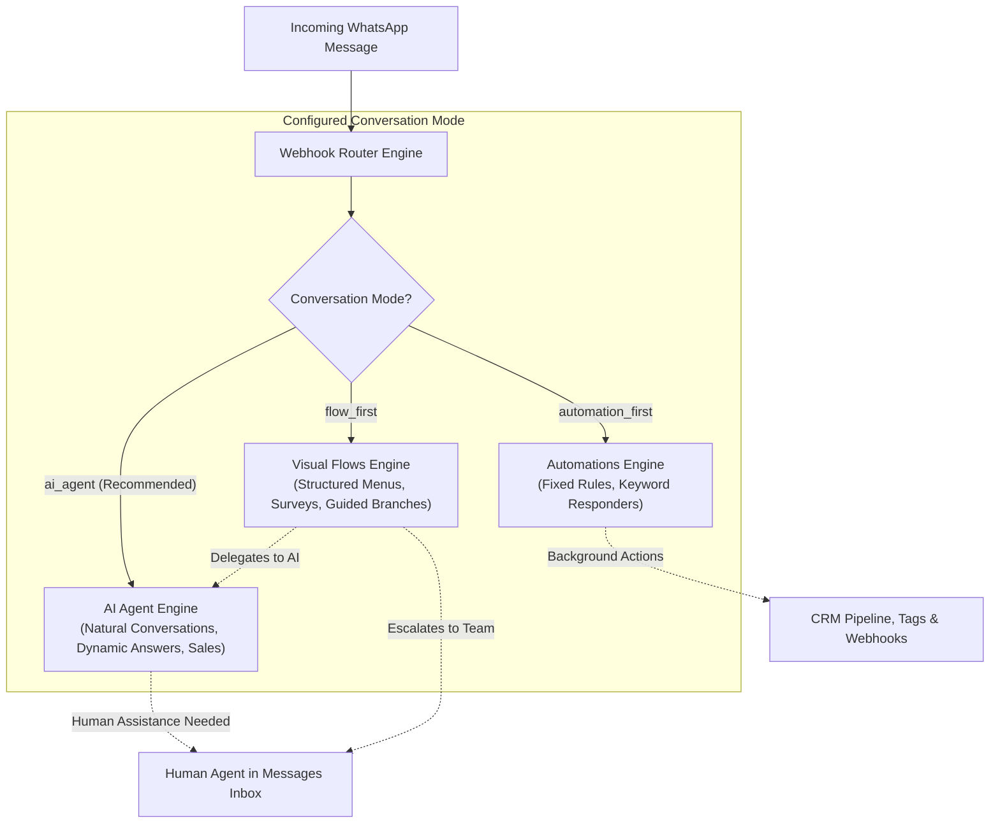
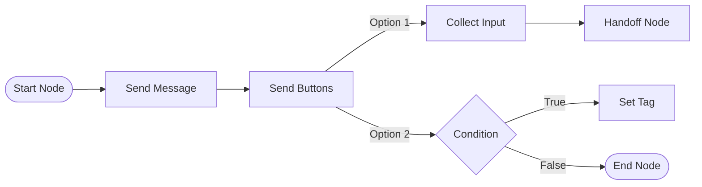
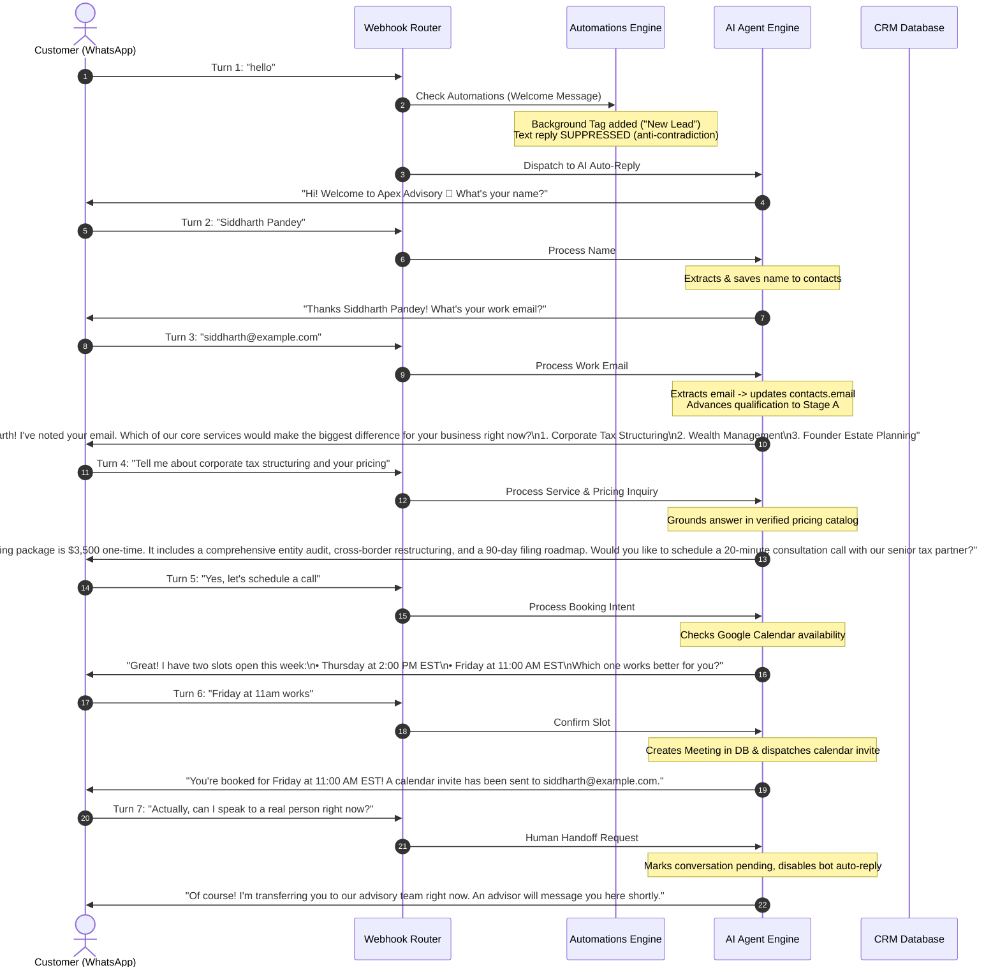

# WATTOMATION — COMPLETE END-USER CONFIGURATION & OPERATIONS MANUAL

> **The Definitive Business Operator & Administrator Guide to AI Agents, Visual Flows, Event Automations, and WhatsApp CRM Engagement**
> **Platform Version:** 0.8.0 (Build `0e7055c`)
> **Target Audience:** Business owners, marketing directors, CRM operators, customer support leads, and workspace administrators.

---

## Table of Contents

1. [Introduction & Verified Feature Status](#1-introduction--verified-feature-status)
   - [1.1 Platform Purpose](#11-platform-purpose)
   - [1.2 Verified Feature Implementation Matrix](#12-verified-feature-implementation-matrix)
2. [Understanding the Three Core Engines](#2-understanding-the-three-core-engines)
   - [2.1 AI Agents (Conversational Intelligence)](#21-ai-agents-conversational-intelligence)
   - [2.2 Flows Beta (Structured Visual Journeys)](#22-flows-beta-structured-visual-journeys)
   - [2.3 Automations (Event-Driven Workflows)](#23-automations-event-driven-workflows)
   - [2.4 Strategic Engine Decision Matrix](#24-strategic-engine-decision-matrix)
3. [Initial Workspace Setup & WhatsApp Readiness](#3-initial-workspace-setup--whatsapp-readiness)
   - [3.1 Access & Account Context](#31-access--account-context)
   - [3.2 Meta WhatsApp Cloud API Connection](#32-meta-whatsapp-cloud-api-connection)
   - [3.3 Connecting AI Provider Credentials](#33-connecting-ai-provider-credentials)
   - [3.4 Safe Pre-Activation Testing Without Messaging Real Customers](#34-safe-pre-activation-testing-without-messaging-real-customers)
4. [AI Agents: Complete Setup & Operations Guide](#4-ai-agents-complete-setup--operations-guide)
   - [4.1 Navigating to AI Agents](#41-navigating-to-ai-agents)
   - [4.2 Business Profile Editor](#42-business-profile-editor)
   - [4.3 Conversation Flow Presets & Stages](#43-conversation-flow-presets--stages)
   - [4.4 Conversation Ownership Mode Setting](#44-conversation-ownership-mode-setting)
   - [4.5 Services, Products & Pricing Rules](#45-services-products--pricing-rules)
   - [4.6 Vector Knowledge Base & Document Indexing](#46-vector-knowledge-base--document-indexing)
   - [4.7 Personality, Tone & Language](#47-personality-tone--language)
   - [4.8 Calendar Booking & Meeting Settings](#48-calendar-booking--meeting-settings)
   - [4.9 Human Handoff & Team Assignment](#49-human-handoff--team-assignment)
   - [4.10 AI Playground Testing](#410-ai-playground-testing)
5. [Visual Flows (Beta): Visual Builder Guide](#5-visual-flows-beta-visual-builder-guide)
   - [5.1 Flow Builder Workspace Overview](#51-flow-builder-workspace-overview)
   - [5.2 Supported Node Types & Configuration](#52-supported-node-types--configuration)
   - [5.3 Variable Interpolation (`{{vars.name}}` vs `{{name}}`)](#53-variable-interpolation-varsname-vs-name)
   - [5.4 Handoff Node Mechanics (Human vs. AI Agent)](#54-handoff-node-mechanics-human-vs-ai-agent)
   - [5.5 Testing, Validation, Activation & Run History](#55-testing-validation-activation--run-history)
6. [Automations: Trigger & Action Guide](#6-automations-trigger--action-guide)
   - [6.1 Trigger Types & Evaluation Rules](#61-trigger-types--evaluation-rules)
   - [6.2 Action Types & Step Execution](#62-action-types--step-execution)
   - [6.3 Background Actions vs. Customer-Facing Replies](#63-background-actions-vs-customer-facing-replies)
   - [6.4 Starter Automation Templates](#64-starter-automation-templates)
   - [6.5 Delays & The 24-Hour WhatsApp Service Window](#65-delays--the-24-hour-whatsapp-service-window)
7. [How to Combine AI Agents, Flows and Automations Without Conflicts](#7-how-to-combine-ai-agents-flows-and-automations-without-conflicts)
   - [7.1 The Single-Conversation-Owner Principle](#71-the-single-conversation-owner-principle)
   - [7.2 Engine Interaction & Precedence Matrix](#72-engine-interaction--precedence-matrix)
   - [7.3 End-to-End Multi-Turn Test Walkthrough (Turns 1–10)](#73-end-to-end-multi-turn-test-walkthrough-turns-110)
8. [Real-World Business Configuration Examples](#8-real-world-business-configuration-examples)
   - [8.1 Example A: General Professional Services Agency](#81-example-a-general-professional-services-agency)
   - [8.2 Example B: Real Estate Brokerage & Property Inquiries](#82-example-b-real-estate-brokerage--property-inquiries)
   - [8.3 Example C: Residential & Commercial Cleaning Services](#83-example-c-residential--commercial-cleaning-services)
   - [8.4 Example D: Professional Coaching & Training Academy](#84-example-d-professional-coaching--training-academy)
   - [8.5 Example E: E-Commerce & Retail Product Inquiries](#85-example-e-e-commerce--retail-product-inquiries)
9. [WhatsApp Messaging Rules, Window & Compliance](#9-whatsapp-messaging-rules-window--compliance)
   - [9.1 24-Hour Customer Care Window](#91-24-hour-customer-care-window)
   - [9.2 Approved Message Templates for Re-Engagement](#92-approved-message-templates-for-re-engagement)
   - [9.3 Interactive Buttons & List Menus](#93-interactive-buttons--list-menus)
   - [9.4 Customer Opt-Out / STOP Handling](#94-customer-opt-out--stop-handling)
10. [Supporting CRM Modules](#10-supporting-crm-modules)
    - [10.1 Messages (Inbox) & Conversation Management](#101-messages-inbox--conversation-management)
    - [10.2 Contacts, Tags & Custom Fields](#102-contacts-tags--custom-fields)
    - [10.3 Meetings & Booking Management](#103-meetings--booking-management)
    - [10.4 Sales Pipelines & Deal Stages](#104-sales-pipelines--deal-stages)
    - [10.5 Bulk Messages (Broadcast Campaigns)](#105-bulk-messages-broadcast-campaigns)
    - [10.6 Website Integrations (Tracking Script & Rules)](#106-website-integrations-tracking-script--rules)
    - [10.7 Notifications & Alerts](#107-notifications--alerts)
    - [10.8 Settings & Team Management](#108-settings--team-management)
11. [Tenant Activation & Launch Checklist](#11-tenant-activation--launch-checklist)
    - [11.1 Pre-Launch Verification Checklist](#111-pre-launch-verification-checklist)
    - [11.2 Post-Launch Monitoring Procedure](#112-post-launch-monitoring-procedure)
12. [Comprehensive Troubleshooting Guide](#12-comprehensive-troubleshooting-guide)
13. [Security, Governance & Emergency Rollback](#13-security-governance--emergency-rollback)
    - [13.1 Emergency Kill-Switch & Pausing Workflows](#131-emergency-kill-switch--pausing-workflows)
    - [13.2 Data Protection & Role Governance](#132-data-protection--role-governance)

---

## 1. Introduction & Verified Feature Status

### 1.1 Platform Purpose
**Wattomation by OPSIYS** is an enterprise-grade WhatsApp Customer Relationship Management (CRM) platform. It allows businesses to automate customer conversations, qualify incoming leads, provide instant support, book calendar appointments, and manage sales deals directly through the official Meta WhatsApp Business Cloud API.

### 1.2 Verified Feature Implementation Matrix
To ensure complete operational reliability, every capability documented in this manual is classified according to its verified runtime status in the deployed product:

| Feature / Module | Implementation Status | Verification Evidence / Operational Notes |
|---|---|---|
| **AI Qualification & Discovery** | **Implemented & Verified** | 100% test coverage; handles greetings, name/email capture, catalog presentation, and pricing. |
| **Email Address Capture** | **Implemented & Verified** | Extracts email from conversational text, saves to `contacts.email`, advances qualification without catalog false-positives. |
| **Conversation Ownership Mode** | **Implemented & Verified** | Switchable in UI (`ai_agent`, `flow_first`, `automation_first`). Prevents duplicate messages. |
| **AI Knowledge Base (RAG)** | **Implemented & Verified** | Document upload, text chunking, embedding generation, vector similarity retrieval. |
| **Visual Flows Builder** | **Implemented & Verified** | Node graph, drag-and-drop canvas, edge routing, variable interpolation, validation. |
| **Flow Handoff Node** | **Implemented & Verified** | Handoff to human or AI; syncs captured lead variables (`name`, `email`, `company`) to `contacts`. |
| **Event Automations Engine** | **Implemented & Verified** | Triggers (`first_inbound_message`, `keyword_match`, `tag_added`, etc.), linear actions, delays. |
| **Single Conversation Owner Engine** | **Implemented & Verified** | Suppresses static welcome automations when AI Agent owns the conversation. |
| **WhatsApp Cloud API Integration** | **Implemented & Verified** | Meta webhook verification, inbound media mirroring, outbound interactive messages. |
| **Customer Opt-Out (STOP)** | **Implemented & Verified** | Immediately halts bot replies, marks conversation paused, tags contact `Opted Out`. |
| **CRM Pipelines & Deals** | **Implemented & Verified** | Drag-and-drop Kanban pipeline board, stage customization, deal value aggregation. |
| **Meetings & Google Calendar** | **Implemented & Verified** | OAuth token encryption, slot availability check, booking record generation. |
| **Bulk Messages (Broadcasts)** | **Implemented & Verified** | CSV upload, template parameter mapping, batch sending with pause/resume support. |
| **Website SDK & Integrations** | **Implemented & Verified** | Embeddable tracking script, event logging, rule-based trigger dispatch. |
| **Live External Order Tracking APIs** | **Not Currently Supported** | External third-party order lookups (e.g. Shopify live query) require custom webhooks; not natively built-in. |
| **Automated Real Estate MLS Sync** | **Not Currently Supported** | Property listings must be entered into AI Knowledge Base; direct MLS/IDX synchronization is not native. |

---

## 2. Understanding the Three Core Engines

Wattomation contains three distinct engines that can communicate with customers over WhatsApp. Understanding their strengths and primary roles is the foundation of successful setup.

### 2.1 AI Agents (Conversational Intelligence)
- **What it is:** An autonomous, LLM-powered virtual assistant grounded in your specific business facts, service offerings, and pricing packages.
- **Best for:** Open-ended customer inquiries, natural language sales qualification, consultative pitching, answering unexpected questions, and scheduling consultations.
- **How it talks:** Friendly, conversational paragraphs. It asks one question at a time, listens to the customer's answer, and tailors the next response.

### 2.2 Flows Beta (Structured Visual Journeys)
- **What it is:** A visual flowchart of connected boxes (nodes) that guides customers through a predetermined sequence of choices.
- **Best for:** Main menus, self-service portals, structured customer surveys, multi-button navigation, and rigid data collection.
- **How it talks:** Interactive buttons (up to 3 buttons), selection list menus (up to 10 choices), and explicit text prompts.

### 2.3 Automations (Event-Driven Workflows)
- **What it is:** A sequence of "When X happens, Do Y" rules that execute behind the scenes.
- **Best for:** Background CRM bookkeeping (e.g., adding a tag when a customer reaches out), delayed follow-ups (e.g., waiting 2 hours before sending a reminder), and external webhook dispatch.
- **How it talks:** Typically silent background actions, or fixed canned messages triggered by exact keyword matches or events.

### 2.4 Strategic Engine Decision Matrix

| Business Goal | Recommended Primary Engine | Recommended Supporting Engine |
|---|---|---|
| **Qualify leads dynamically from ads** | **AI Agent** (`ai_agent` mode) | Background Automations for CRM tagging. |
| **Welcome menu with button options** | **Visual Flow** (`flow_first` mode) | Handoff Node to AI Agent for detailed service questions. |
| **After-hours Out-of-Office auto-reply** | **Automations** (`time_based` / condition) | AI Agent resumes during business hours. |
| **Survey with 4 rigid questions** | **Visual Flow** (`collect_input` nodes) | Syncs captured lead data to CRM contact fields. |
| **Direct appointment booking** | **AI Agent** (`appointment_booking` preset) | Google Calendar integration via Meetings module. |

---

## 3. Initial Workspace Setup & WhatsApp Readiness

Follow this step-by-step checklist to configure a new workspace before activating live messaging.

### 3.1 Access & Account Context
1. Log in to Wattomation at your company workspace URL.
2. In the top-left sidebar header, verify your **Account Name** and your assigned role chip (**Owner** or **Admin** is required to access system settings).
3. If you manage multiple business entities, click your account name in the sidebar to switch to the correct tenant account.

### 3.2 Meta WhatsApp Cloud API Connection
To send and receive WhatsApp messages, Wattomation connects directly to Meta's official WhatsApp Business Cloud API.

#### Prerequisites from Meta Developer Portal:
- A verified Meta Business Manager account.
- A Meta WhatsApp Business App created at `developers.facebook.com`.
- A registered phone number not currently active on the consumer WhatsApp or WhatsApp Business mobile apps.
- Your **Phone Number ID**, **WhatsApp Business Account ID (WABA ID)**, and a **System User Permanent Access Token** with `whatsapp_business_messaging` and `whatsapp_business_management` permissions.

#### Connection Procedure:
1. Navigate to **Settings** (`/settings`) from the left sidebar, then click the **WhatsApp** tab.
2. Review the **Connection Status** card:
   - If not connected, paste your **Phone Number ID**, **WABA ID**, and **Access Token**.
   - Click **Save & Connect**.
3. **Verify Registration:**
   - Click **Verify Meta Registration & Webhooks**.
   - The system performs a live diagnostic probe against Meta's Graph API.
   - Status will display **Connected** with a green badge, indicating outbound sending and inbound webhooks are active.
4. **Inbound Media Mirroring:**
   - Ensure the toggle **Mirror inbound media to local storage** is enabled (ON). This preserves photos and audio sent by customers in your Supabase storage beyond Meta's standard 30-day temporary retention.

> [!IMPORTANT]
> Never share, paste into chat, or commit your WhatsApp Access Token. The system securely encrypts tokens at rest using AES-256-GCM before saving them to the database.

### 3.3 Connecting AI Provider Credentials
Wattomation supports three AI LLM providers:
1. **OpenAI:** Uses official OpenAI models (`gpt-4o`, `gpt-4o-mini`).
2. **Anthropic:** Uses Claude models (`claude-3-5-sonnet`, `claude-3-haiku`).
3. **OpenAI-Compatible (Custom / Self-Hosted):** Supports Cloudflare Workers AI, Groq, Together AI, vLLM, or Ollama endpoints.

#### Configuration Steps:
1. Navigate to **AI Agents** (`/agents`) from the sidebar, then select the **Setup** tab.
2. Click the **Provider & Models** sub-tab.
3. Select your desired provider from the dropdown.
4. Enter your secret API Key:
   - For OpenAI: `sk-...`
   - For Anthropic: `sk-ant-...`
   - For OpenAI-Compatible: Enter your API key and specify the **Base URL** (e.g. `https://api.groq.com/openai/v1` or Cloudflare Workers AI gateway URL).
5. Specify the **Model ID** (e.g., `gpt-4o-mini` or `@cf/meta/llama-3.1-8b-instruct`).
6. Click **Test AI Connection**. A test prompt is sent to verify that the key is valid and decryptable.
7. Click **Save AI Configuration**.

### 3.4 Safe Pre-Activation Testing Without Messaging Real Customers
To test Wattomation safely without sending uncontrolled messages to real clients:
1. Go to **AI Agents** → **Playground** tab (`/agents?tab=playground`).
2. The Playground simulates full conversation flows in-memory without contacting WhatsApp or incurring Meta messaging fees.
3. For live WhatsApp verification, add an internal company phone number as a test contact in **Contacts** (`/contacts`).
4. Ensure the **Welcome Message** automation in `/automations` is set to **Inactive** until testing is complete.

---

## 4. AI Agents: Complete Setup & Operations Guide

### 4.1 Navigating to AI Agents
Click **AI Agents** in the primary navigation sidebar (`/agents`). The page contains three main tabs:
- **Playground:** Interactive chat simulator for testing conversation behavior.
- **Setup:** The comprehensive control panel for profiles, flows, pricing, knowledge, and credentials.
- **Usage:** Real-time analytics tracking token consumption, message counts, and API costs.

### 4.2 Business Profile Editor
Located in **AI Agents** → **Setup** → **Business Profile** sub-tab.

| Setting Name | Input Type | Description & Purpose | Realistic Example |
|---|---|---|---|
| **Company Name** | Text Field | The legal or trading name of your business. | `Apex Financial Advisory` |
| **Industry Preset** | Dropdown | Sets baseline terminology and default qualification logic. | `Financial & Legal Services` |
| **One-Line Value Proposition** | Text Field | A crisp summary of what you do and who you help. | `We help tech founders structure wealth and optimize corporate tax.` |
| **Target Audience** | Textarea | Defines your ideal client profile so the AI qualifies effectively. | `Founders, executives, and high-net-worth business owners.` |
| **Key Differentiators** | Textarea | What sets you apart from competitors. | `Fiduciary-only, zero commissions, dedicated tax attorney on staff.` |
| **Contact Email & Phone** | Text Field | Official business contact information for escalation. | `advisory@apexwealth.com / +1-555-019-2834` |
| **Business Hours & Timezone** | Fields | Opening hours for conversational reference. | `Mon-Fri: 9:00 AM - 6:00 PM EST` |

### 4.3 Conversation Flow Presets & Stages
Located in **AI Agents** → **Setup** → **Flow & Stages** sub-tab.

Select the preset that aligns with your operational sales model:
1. **Service Inquiry → Pricing or Consultation (Recommended):**
   - *Behavior:* Identifies the service of interest, explains benefits, and offers two clear paths: explore transparent pricing or book a consultation call.
2. **Lead Qualification → Consultation Booking:**
   - *Behavior:* Asks up to 2 focused qualification questions (e.g. business size, primary challenge) before inviting the customer to schedule a discovery meeting.
3. **Pricing & Package Inquiry:**
   - *Behavior:* Explains packages and prices up front, then guides the lead toward booking a consultation for customized needs.
4. **Direct Appointment Booking:**
   - *Behavior:* Immediately recognizes scheduling intent and checks calendar availability.
5. **Customer Support & FAQ:**
   - *Behavior:* Answers questions strictly from indexed knowledge base documents and escalates unverified inquiries to human agents.
6. **Hybrid / Human-Handoff Flow:**
   - *Behavior:* Captures name and requirement, then immediately assigns the conversation to an available agent in the Messages Inbox.

### 4.4 Conversation Ownership Mode Setting
Located at the top of the **Flow & Stages** tab. This controls the single conversational owner for your entire workspace:

- **AI Agent First (Recommended):**
  - The AI Agent owns greetings, qualification questions, and consultative dialogue.
  - Conversational automations with static greetings are automatically suppressed so the customer receives exactly one greeting.
  - Background automations (tagging, pipeline deal creation, webhooks) continue to execute freely.
- **Visual Flow First:**
  - Active visual Flows handle the conversation. The AI Agent will only engage if a Flow explicitly transitions to an AI Handoff node.
- **Automation First:**
  - Keyword and message automations handle customer messages. The AI Agent only replies as a fallback if no automation matched.

### 4.5 Services, Products & Pricing Rules
Located in **AI Agents** → **Setup** → **Pricing & Rules** sub-tab.

The AI Agent is strictly **fact-grounded**. It will **never invent prices** or offer services that are not explicitly documented here.

#### Defining Services:
- Click **Add Service Item**.
- **Service Name:** Exact name (e.g., `Growth Marketing Audit`).
- **Description:** 2–3 sentences explaining what is included.
- **Keywords:** Trigger words (e.g., `audit, marketing review, growth strategy`).
- **Benefits:** 2–3 specific customer benefits (e.g., `identifies conversion bottlenecks`, `delivers 90-day action plan`).

#### Defining Pricing Packages:
- Click **Add Pricing Package**.
- **Package Name:** (e.g., `Starter Audit`, `Comprehensive Retainer`).
- **Price:** Formatted string with currency (e.g., `$1,500 one-time` or `$3,500/month`).
- **Scope & Limitations:** What is included and what requires a custom quote.

> [!TIP]
> If your pricing is customized, enter `Custom proposal following discovery call` as the price. The AI Agent will explain that pricing depends on scope and seamlessly transition to scheduling a consultation.

### 4.6 Vector Knowledge Base & Document Indexing
Located in **AI Agents** → **Setup** → **Knowledge Base** card.

The Knowledge Base allows the AI Agent to answer complex operational questions (policies, warranties, technical specs, onboarding FAQs) using Retrieval-Augmented Generation (RAG).

#### Adding Knowledge Documents:
1. Click **Add Document** or **Upload Document**.
2. **Title:** Give the document a descriptive name (e.g., `Refund Policy & Guarantee Terms`).
3. **Content:** Paste plain text or upload Markdown/PDF files.
4. Click **Save & Index Document**.
5. The system automatically chunks the text into semantic sections, computes embeddings, and stores them in the vector database.

### 4.7 Personality, Tone & Language
Located in **AI Agents** → **Setup** → **Personality & Tone** sub-tab.

- **Tone of Voice:** Select from `Professional & Consultative`, `Warm & Friendly`, `Direct & Efficient`, or `Casual & Modern`.
- **Formatting Style:**
  - `WhatsApp Optimized (Short Paragraphs & Bullet Points)`: Recommended for clean mobile readability.
  - `Use Emojis Judiciously`: Adds friendly icons (`👋`, `💼`, `✅`) without cluttering text.
- **Primary Language:** Select default language or choose `Auto-detect & match customer language` to reply in the customer's native language automatically.

### 4.8 Calendar Booking & Meeting Settings
Located in **Meetings** (`/meetings`) and configured under **Meeting Settings**.

- **Google Calendar Sync:** Connect your Google Workspace or Gmail calendar. The system encrypts OAuth refresh tokens securely.
- **Buffer Times:** Set 15-minute buffers between calls to prevent back-to-back overbooking.
- **Working Hours:** Configure available slots (e.g., 10:00 AM - 5:00 PM).
- **Confirmation Behavior:** The AI Agent will offer two real available time slots. When the customer confirms a slot, a meeting row is created in the database and an invitation is dispatched.

### 4.9 Human Handoff & Team Assignment
Located in **AI Agents** → **Setup** → **Message Templates** and **Settings** → **Members**.

When a customer asks for a person (e.g., *"Can I speak to someone?"* or *"Transfer me to an agent"*):
1. The AI Agent acknowledges the request politely using the configured Handoff Template.
2. The conversation's `assigned_agent_id` is updated, or set to the shared team queue.
3. The conversation's `ai_autoreply_disabled` flag is set to `true`, instantly silencing the bot.
4. A notification alert is dispatched to workspace agents in **Notifications** (`/notifications`).

### 4.10 AI Playground Testing
Before enabling customer-facing auto-replies:
1. Go to **AI Agents** → **Playground** (`/agents?tab=playground`).
2. Type `hello` into the chat input.
3. Verify that the agent greets you with your configured company name.
4. Provide a name and email address. Verify that the agent acknowledges both properly.
5. Inquire about pricing. Verify that the agent quotes only your configured package rates.
6. Ask an out-of-scope question (e.g. *"Do you sell lawnmowers?"*). Verify that the agent politely states it cannot assist with that and re-anchors to your core services.

---

## 5. Visual Flows (Beta): Visual Builder Guide

Visual Flows allow you to build interactive, button-driven customer journeys using a visual node canvas powered by `@xyflow/react`.

### 5.1 Flow Builder Workspace Overview
Navigate to **Flows** (`/flows`) in the primary sidebar.
- **Flow List:** Displays all saved flows, their triggers, and status (**Active** or **Draft**).
- **Create Flow:** Click **Create Flow** to open the visual builder canvas.
- **Controls:** Use scroll to zoom, click and drag the canvas to pan, and click any node to open its configuration drawer on the right.

### 5.2 Supported Node Types & Configuration

#### 1. Start Node (`start`)
- **Purpose:** Entry point for the flow.
- **Configuration:** Connect its output handle to the first interactive node of your flow.

#### 2. Send Message Node (`send_message`)
- **Purpose:** Dispatches a plain text message to the customer and auto-advances.
- **Configuration:** Enter the text body. Supports variable interpolation (e.g., `Welcome {{vars.name}}!`).

#### 3. Send Buttons Node (`send_buttons`)
- **Purpose:** Displays a message bubble with 1 to 3 interactive tap buttons (enforced by Meta limits).
- **Configuration:**
  - **Body Text:** Main prompt text.
  - **Header / Footer (Optional):** Short secondary text.
  - **Buttons (1–3):** Each button requires a **Button Title** (≤ 20 characters) and a **Button ID**.
  - **Routing:** Each button has an independent output handle. Drag an edge from each button to its target destination node.

#### 4. Send List Node (`send_list`)
- **Purpose:** Displays an interactive menu button that opens a selection sheet with up to 10 choices across multiple sections.
- **Configuration:**
  - **Button Label:** The text on the tap-to-open bubble (e.g., `View Services`).
  - **Sections & Rows:** Add up to 10 rows total. Each row has a Title, optional Description, and an independent output handle.

#### 5. Send Media Node (`send_media`)
- **Purpose:** Sends an image, video, or PDF document.
- **Configuration:** Select the media type, upload the file to Supabase storage, and optionally add a caption.

#### 6. Collect Input Node (`collect_input`)
- **Purpose:** Pauses the flow and waits for the customer to reply with free text.
- **Configuration:**
  - **Prompt Text:** The question asked (e.g. *"What is your work email?"*).
  - **Variable Key (`var_key`):** The variable name under which the answer is stored (e.g., `email` or `company_name`).

#### 7. Condition Node (`condition`)
- **Purpose:** Evaluates contact data or captured variables and branches into **True** (Yes) or **False** (No) paths.
- **Configuration:**
  - **Subject:** Choose from `Variable` (`vars`), `Contact Tag`, or `Contact Field` (`name`, `email`, `phone`, `company`).
  - **Operator:** Choose from `equals`, `contains`, `present`, or `absent`.
  - **True / False Routing:** Connect separate edges to the True and False handles.

#### 8. Set Tag Node (`set_tag`)
- **Purpose:** Attaches or removes a CRM tag from the contact record.
- **Configuration:** Select the tag from your existing workspace tags and choose `Add` or `Remove`.

#### 9. Handoff to Agent Node (`handoff`)
- **Purpose:** Concludes the structured flow and transfers the conversation.
- **Configuration:**
  - **Target:**
    - `Human Agent` (Default): Marks conversation `pending` or assigns to a specific teammate.
    - `AI Agent`: Delegates conversation control to the AI Agent.
  - **Handoff Message:** The message sent to the customer upon handoff (e.g. `Thank you {{vars.name}}! Our team will be in touch shortly.`).
  - **Automatic Lead Sync:** The engine automatically copies captured `name`, `email`, and `company` variables directly to the `contacts` table.

#### 10. End Node (`end`)
- **Purpose:** Cleanly terminates the flow run and marks its status `completed`.

### 5.3 Variable Interpolation (`{{vars.name}}` vs `{{name}}`)
In prompt texts and messages, you can personalize messages using customer variables:
- Both `{{vars.name}}` and `{{name}}` are supported.
- Both `{{vars.email}}` and `{{email}}` are supported.
- If a variable has not been collected yet, it renders safely as an empty string without breaking the flow.

### 5.4 Handoff Node Mechanics (Human vs. AI Agent)
- When set to **Human Agent**, the conversation status updates to `pending`, notifying human team members. If no custom handoff message is configured, the system provides a safe default confirmation so the customer is never left in silence.
- When set to **AI Agent**, control transfers seamlessly to the AI qualification engine.

### 5.5 Testing, Validation, Activation & Run History
1. **Validation Engine:** Click **Validate Flow**. The builder verifies that no nodes are disconnected, all buttons have valid targets, and all required text fields are populated.
2. **Activation:** Toggle the status from **Draft** to **Active**.
3. **Inspecting Run History:** Click the **Runs** tab on any flow to see live execution logs, node-by-node timestamps, captured variables, and any errors.

---

## 6. Automations: Trigger & Action Guide

Automations in `/automations` handle event-driven and background CRM workflows.

### 6.1 Trigger Types & Evaluation Rules

| Trigger Type | When it Fires | Deduplication & Execution Rules |
|---|---|---|
| **First Inbound Message (`first_inbound_message`)** | A contact sends their first WhatsApp message ever. | Executes exactly once per contact lifetime. |
| **New Message Received (`new_message_received`)** | Any incoming customer message lands. | Evaluated on every inbound message unless consumed by an active Flow. |
| **Keyword Match (`keyword_match`)** | Customer message matches configured trigger words. | Supports `exact`, `contains`, and boundary-aware `word` matching. |
| **New Contact Created (`new_contact_created`)** | A contact is created manually or via CSV import. | Executes once upon contact insertion. |
| **Tag Added (`tag_added`)** | A specific tag is applied to a contact. | Protected by a maximum depth limit of 3 to prevent infinite loops. |
| **Conversation Assigned (`conversation_assigned`)** | A thread is assigned to an agent. | Fires when `assigned_agent_id` changes. |
| **Interactive Button Reply (`interactive_reply`)** | Customer taps a button with a matching Reply ID. | Allows automations to link with interactive messages. |

### 6.2 Action Types & Step Execution

- **Send Message:** Sends plain text with variable interpolation (`{{contact.name}}`, `{{contact.email}}`).
- **Send Buttons:** Sends 1–3 interactive buttons.
- **Send List:** Sends a selection list menu.
- **Send Template:** Sends an approved Meta template message. (Essential for messaging outside the 24-hour service window).
- **Add Tag / Remove Tag:** Attaches or detaches workspace tags.
- **Update Contact Field:** Updates contact fields (`name`, `email`, `company`, or custom fields).
- **Create Deal:** Automatically creates a CRM deal in a designated sales pipeline and stage.
- **Assign Conversation:** Assigns conversation to a specific teammate or uses round-robin assignment.
- **Wait (Delay):** Pauses execution for a specified duration (e.g. `10 minutes`, `2 hours`).
- **Condition:** Branches workflow based on contact tags, attributes, or time of day.
- **Send Webhook:** Dispatches an HTTP POST payload with contact data to external URLs (e.g. Zapier, Make, n8n). Protected by SSRF guards.
- **Close Conversation:** Marks conversation as closed.

### 6.3 Background Actions vs. Customer-Facing Replies
- **Customer-Facing Replies:** Actions like `Send Message`, `Send Buttons`, and `Send Template` send visible text bubbles to the customer's WhatsApp chat.
- **Background Actions:** Actions like `Add Tag`, `Create Deal`, `Assign Conversation`, and `Send Webhook` run silently in the background.
- **Rule:** In `ai_agent` mode, customer-facing welcome replies are automatically suppressed, while background actions run freely.

### 6.4 Starter Automation Templates
Wattomation provides 4 built-in starter automation templates:
1. **Welcome Message:** Greets new contacts and adds a `New Lead` tag.
2. **Out of Office:** Checks if the message arrived outside business hours (18:00–09:00) and sends an after-hours notice.
3. **Lead Qualifier:** Matches keywords (e.g. `quote, pricing, services`), sends preliminary info, waits 10 minutes, and assigns to an agent.
4. **Follow-up Reminder:** Waits 23 hours after an unanswered message and sends a gentle check-in before the 24-hour window closes.

### 6.5 Delays & The 24-Hour WhatsApp Service Window
Meta enforces a strict **24-hour customer service window**. Free-form text messages can only be sent within 24 hours of the customer's last message.
- Wattomation's automation engine caps wait steps at **23 hours** to prevent message expiration.
- After 24 hours, all outgoing messages must use pre-approved **Meta Message Templates**.

---

## 7. How to Combine AI Agents, Flows and Automations Without Conflicts

### 7.1 The Single-Conversation-Owner Principle
When multiple automated systems reply to the same customer simultaneously, the result is contradictory and confusing (e.g., sending a welcome greeting, an out-of-office message, and an AI question all in the same second).

To eliminate this, Wattomation enforces the **Single-Conversation-Owner Principle**:
> **At any given moment, exactly one conversational engine owns the dialogue with the customer.**

### 7.2 Engine Interaction & Precedence Matrix

| Mode Selected | Primary Owner | Flow Behavior | Automation Behavior | AI Agent Behavior |
|---|---|---|---|---|
| **`ai_agent` (Recommended)** | **AI Agent** | Only starts if customer sends an exact matching Flow keyword. | Customer-facing text replies are suppressed. Background actions (tags, deals, webhooks) execute normally. | Owns greetings, qualification questions, and appointment scheduling. |
| **`flow_first`** | **Visual Flow** | Active flow consumes customer inputs and guides the journey. | Suppressed while flow is running. | Silent until Flow hits an explicit AI Handoff node. |
| **`automation_first`** | **Automations** | Inactive unless keyword triggered. | Matching automations send replies and take ownership. | Acts as fallback if no automation matches. |

### 7.3 End-to-End Multi-Turn Test Walkthrough (Turns 1–10)

Here is the exact runtime trace of a complete, 10-turn customer conversation running in **AI Agent First** mode:

---

## 8. Real-World Business Configuration Examples

### 8.1 Example A: General Professional Services Agency
- **Company Name:** `Vanguard Strategy Partners`
- **Industry Preset:** `Consulting & Professional Services`
- **One-Line Value Proposition:** `B2B growth strategy and operational scaling for mid-market software companies.`
- **Services Defined:**
  1. `Go-To-Market Diagnostic`: Comprehensive audit of sales funnel and pricing architecture. ($4,000)
  2. `Quarterly Growth Advisory`: Ongoing bi-weekly strategic roadmap and leadership coaching. ($6,500/month)
- **Qualification Logic:** AI asks for current annual recurring revenue (ARR) and main bottleneck before offering calendar booking.
- **Expected Conversation:** Customer sends `Hi`, AI collects Name → Work Email → ARR Range → Service Selection → Meeting Booking.
- **Data Persisted:** Contact Name, Work Email, ARR Tag (`$1M-$5M`), CRM Deal created in `New Qualified Leads` stage.

### 8.2 Example B: Real Estate Brokerage & Property Inquiries
- **Company Name:** `Verelle Luxury Real Estate`
- **Industry Preset:** `Real Estate & Property`
- **One-Line Value Proposition:** `Exclusive luxury residential properties and investment estates in Miami and Palm Beach.`
- **Verified Knowledge Base:** Insert text documents detailing current active neighborhood portfolio highlights, average square-footage prices, and purchase policies.
- **Limitation Notice:** Wattomation does not natively integrate with live MLS feeds; inventory highlights are maintained in the Knowledge Base.
- **Qualification Logic:** AI asks whether the client is looking to `Buy`, `Rent`, or `Sell`, followed by `Target Neighborhood` and `Budget Range`.
- **Expected Conversation:** Collects budget → confirms location interest → routes to dedicated listing specialist via Human Handoff node.

### 8.3 Example C: Residential & Commercial Cleaning Services
- **Company Name:** `AuraClean Pro Services`
- **Industry Preset:** `Home Services & Maintenance`
- **One-Line Value Proposition:** `Premium eco-friendly residential and commercial deep cleaning.`
- **Pricing Packages Configured:**
  1. `Standard Residential Clean`: `$180 per visit (up to 3 bedrooms)`
  2. `Deep Move-In/Move-Out Clean`: `$320 one-time`
  3. `Commercial Office Sanitization`: `Custom quote based on square footage`
- **Qualification Logic:** AI asks for property type (home vs. office), number of rooms, and preferred service date before quoting.
- **Data Persisted:** Contact phone number, cleaning frequency tag (`Bi-Weekly`), deal created in `Booking In Progress`.

### 8.4 Example D: Professional Coaching & Training Academy
- **Company Name:** `Horizon Executive Leadership Academy`
- **Industry Preset:** `Education & Coaching`
- **One-Line Value Proposition:** `Executive presence, negotiation mastery, and leadership coaching for senior directors.`
- **Services Defined:**
  1. `Leadership Accelerator (8-Week Cohort)`: `$2,400 per participant`
  2. `1-on-1 Executive Coaching Retainer`: `$5,000 / quarter`
- **Qualification Logic:** AI identifies whether the lead seeks corporate sponsorship or individual coaching, collects work email, and books an interview call.

### 8.5 Example E: E-Commerce & Retail Product Inquiries
- **Company Name:** `Lumen Living Decor`
- **Industry Preset:** `Retail & E-Commerce`
- **One-Line Value Proposition:** `Handcrafted minimalist home lighting and architectural ceramic fixtures.`
- **Knowledge Base Setup:** FAQ document covering shipping times (3–5 business days), return policy (30 days risk-free), and warranty details (2-year replacement).
- **Limitation Notice:** Live order tracking requires configuring an outbound webhook to your logistics provider; the AI Agent answers policies and product specifications directly from the knowledge base.

---

## 9. WhatsApp Messaging Rules, Window & Compliance

### 9.1 24-Hour Customer Care Window
- Whenever a customer messages your WhatsApp number, a **24-hour customer care session** opens.
- Within this 24-hour window, you and your automated bots can send free-form text, images, videos, audio, interactive buttons, and list menus without Meta per-message template fees.
- When 24 hours pass without a customer reply, the window closes. The platform will automatically block standard text sends to prevent Meta policy violations.

### 9.2 Approved Message Templates for Re-Engagement
- To re-engage a customer after the 24-hour window has expired, you must send an approved **Meta Message Template**.
- Navigate to **Settings** → **Templates** (`/settings?tab=templates`) to sync or submit new templates.
- Categories supported: `Utility`, `Marketing`, and `Authentication`.

### 9.3 Interactive Buttons & List Menus
- **Buttons (`send_buttons`):** Limited by Meta to a maximum of 3 buttons per message bubble, with button titles capped at 20 characters.
- **List Menus (`send_list`):** Limited to a maximum of 10 rows across all sections. Tapping opens a sleek native drawer on mobile.

### 9.4 Customer Opt-Out / STOP Handling
Wattomation includes built-in compliance with global messaging regulations:
- If a customer replies with `STOP`, `UNSUBSCRIBE`, `CANCEL`, or `QUIT`:
  1. The AI Agent immediately halts automated replies.
  2. The conversation status is flipped to `paused`.
  3. The contact is automatically tagged `Opted Out`.
  4. The system confirms the opt-out with a compliant cancellation confirmation.

---

## 10. Supporting CRM Modules

### 10.1 Messages (Inbox) & Conversation Management
Navigate to **Messages** (`/inbox`).
- **Live Threading:** View incoming messages in real-time via Supabase realtime channels.
- **Human Takeover:** Typing and sending any manual reply as an agent automatically silences the AI bot for that conversation.
- **Sidebar Contact Details:** Inspect custom fields, attached tags, and active deals directly alongside the chat thread.

### 10.2 Contacts, Tags & Custom Fields
Navigate to **Contacts** (`/contacts`).
- **Contacts Table:** Search, filter by tags, and export customer data.
- **Custom Fields:** Managed under **Settings** → **Fields & Tags** (`/settings?tab=fields`). Add custom text, number, date, or dropdown fields.

### 10.3 Meetings & Booking Management
Navigate to **Meetings** (`/meetings`).
- Displays upcoming client consultations, attendee emails, Google Meet links, and status (`Confirmed`, `Cancelled`, `Completed`).

### 10.4 Sales Pipelines & Deal Stages
Navigate to **Pipelines** (`/pipelines`).
- Visual Kanban board showing deals moving across customizable stages (e.g. `New Qualified`, `Discovery Call Scheduled`, `Proposal Sent`, `Won`).

### 10.5 Bulk Messages (Broadcast Campaigns)
Navigate to **Bulk Messages** (`/broadcasts`).
- Send targeted notifications or announcements to thousands of opted-in contacts using approved WhatsApp templates.
- Upload a CSV with contact phone numbers and template parameters.

### 10.6 Website Integrations (Tracking Script & Rules)
Navigate to **Website Integrations** (`/website-integrations`).
- Copy your unique JavaScript tracking snippet to embed into your corporate website.
- Set rules to trigger automated WhatsApp messages when visitors perform key actions (e.g. submitting a web form).

### 10.7 Notifications & Alerts
Navigate to **Notifications** (`/notifications`).
- Real-time alerts for incoming human handoffs, new deals created, and meeting bookings.

### 10.8 Settings & Team Management
Navigate to **Settings** (`/settings`).
- **Members Tab (`?tab=members`):** Invite teammates, assign roles (`Owner`, `Admin`, `Agent`, `Viewer`), and configure round-robin routing.
- **API Keys (`?tab=api`):** Generate API keys for custom developer integrations.

---

## 11. Tenant Activation & Launch Checklist

### 11.1 Pre-Launch Verification Checklist
Complete this checklist before announcing your WhatsApp number to the public:

- [ ] **WhatsApp Connection:** Green **Connected** badge in **Settings** → **WhatsApp**.
- [ ] **AI Provider Verified:** Successful response received from **Test AI Connection**.
- [ ] **Business Profile Completed:** Company name, value proposition, and contact email populated.
- [ ] **Services & Pricing Grounded:** At least 2 core services and pricing packages defined.
- [ ] **Conversation Ownership Mode Set:** **AI Agent First** selected in **AI Agents** → **Setup** → **Flow & Stages**.
- [ ] **Welcome Automation Disarmed:** Starter `Welcome Message` automation is disabled or verified to not send competing text.
- [ ] **Handoff Notifications Tested:** Verified that asking for a human agent alerts your team.
- [ ] **Playground Simulator Tested:** Multi-turn conversation simulated cleanly from `hello` through qualification.

### 11.2 Post-Launch Monitoring Procedure
During the first 48 hours of live customer engagement:
1. Keep the **Messages Inbox** (`/inbox`) open to monitor conversations in real-time.
2. Verify that captured customer names and work emails appear correctly in the contact sidebar.
3. Check **AI Agents** → **Usage** tab daily to review token volume and operational costs.

---

## 12. Comprehensive Troubleshooting Guide

| Symptom | Likely Cause | Verification Method | Safe Resolution | When to Escalate to Developer |
|---|---|---|---|---|
| **AI Agent does not reply to incoming messages** | AI Auto-Reply disabled, conversation owned by human, or cap reached. | Check conversation in Inbox: look for assigned agent or red handoff badge. | In Inbox, unassign human agent or clear `ai_autoreply_disabled` toggle. | If server logs show `[ai config] API key could not be decrypted`. |
| **Conversation stops after customer supplies work email** | Outdated software build or false-positive service catalog match. | Check version in manual (`0e7055c` or newer required). | Ensure you are on build `0e7055c` where Step 8B auto-advances qualification. | If contact email is saved but qualification stage does not advance. |
| **Customer receives duplicate welcome greetings** | Both Welcome Message Automation and AI Agent are active simultaneously. | Check `/automations`: look for active `Welcome Message` trigger. | Set Conversation Mode to `ai_agent` (auto-suppresses duplicate replies) or deactivate the automation. | If duplicate messages persist despite `ai_agent` mode. |
| **Visual Flow stops unexpectedly at Handoff node** | Node has no handoff message and target is set to Human with no agent. | Inspect Flow Builder → click Handoff Node → check configuration drawer. | Add a friendly confirmation message (e.g. `Thanks {{vars.name}}, we will be in touch!`). | If flow run status shows `failed` instead of `handed_off`. |
| **AI invents a price or quotes incorrect rate** | Information missing from Pricing tab; LLM hallucinating. | Check **AI Agents** → **Setup** → **Pricing & Rules**. | Add the exact service name and fixed price package to the Pricing tab. | If model ignores configured pricing limits. |
| **Google Calendar slots not appearing** | Expired Google OAuth token or timezone mismatch. | Check **Meetings** → **Settings** → **Calendar Sync**. | Re-authenticate Google Calendar account in Meeting Settings. | If token decryption fails with cipher error. |
| **WhatsApp rejects outbound messages** | Customer 24-hour service window expired, or invalid phone number format. | Check message delivery status in Inbox (look for red exclamation mark). | Send an approved WhatsApp Message Template instead of free-form text. | If Meta API returns Error 131030 or account suspension notice. |

---

## 13. Security, Governance & Emergency Rollback

### 13.1 Emergency Kill-Switch & Pausing Workflows
If an automated workflow behaves unexpectedly:
- **To pause the AI Agent globally:**
  1. Go to **AI Agents** → **Setup** → **Provider & Models**.
  2. Toggle **Enable AI Auto-Reply** to **OFF**.
  3. Click **Save AI Configuration**. All AI generation stops immediately; conversations fall back to human agents.
- **To pause a specific Flow:**
  1. Go to **Flows** (`/flows`).
  2. Click the status switch next to the flow to set it to **Draft**.
- **To silence a single conversation:**
  1. Open the conversation in **Messages Inbox** (`/inbox`).
  2. Assign yourself or any teammate as the agent. The automated bot stands down instantly.

### 13.2 Data Protection & Role Governance
- **Role Permissions:**
  - **Owner:** Full billing, account deletion, and team transfer control.
  - **Admin:** Can edit flows, AI settings, WhatsApp connections, and manage members.
  - **Agent:** Can read/write messages in Inbox, manage assigned contacts, and create deals.
  - **Viewer:** Read-only visibility into analytics and conversations.
- **Encryption at Rest:** All Meta access tokens, AI provider keys, and Google Calendar tokens are encrypted using AES-256-GCM. Workspace operators should never attempt raw database edits or manual key rotations without developer oversight.
