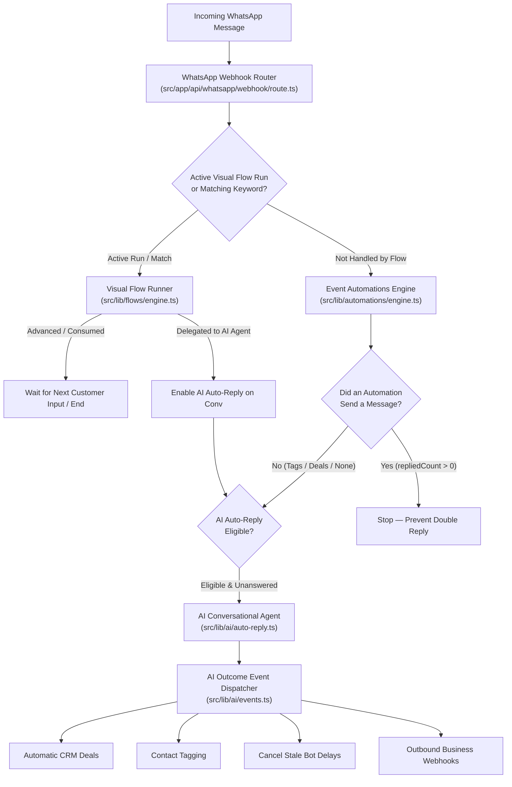
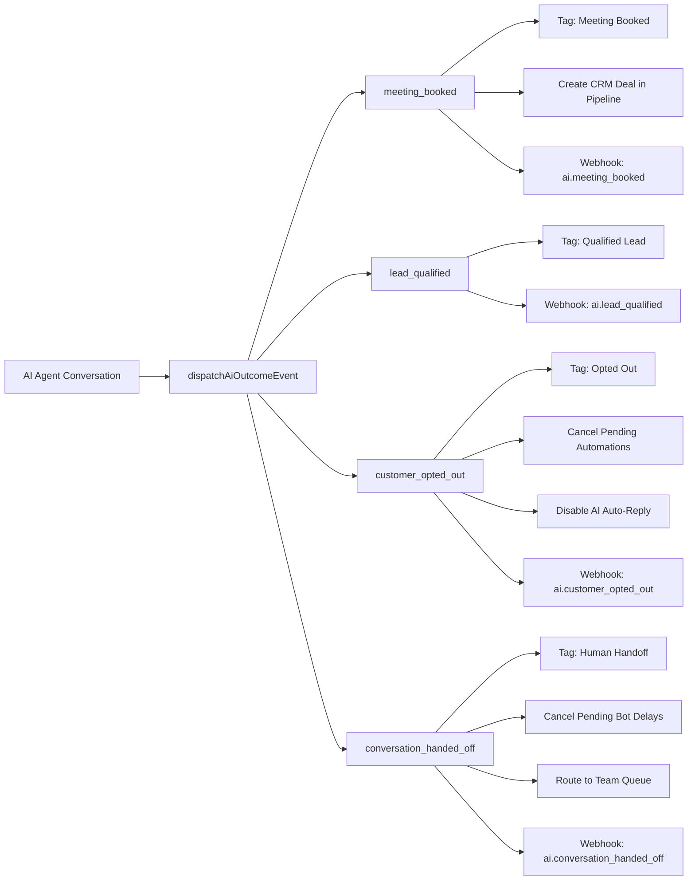

# WATTOMATION — CONFIGURATION & OPERATIONS MANUAL
## Unified AI Agents, Visual Flows & Event-Driven Automations

**Version:** 1.0.0
**Target Platform:** Wattomation CRM (`wacrm`)
**Maintained by:** OPSIYS Engineering & Operations

---

## 1. Executive Summary & Architectural Overview

Wattomation unifies three distinct WhatsApp communication engines into a single, cohesive, production-grade engagement platform:



### Core Architecture Pillars

1. **Visual Flows (`@xyflow/react` + Supabase Node Graph):**
   - Ideal for structured menus, initial branch selection, surveys, multi-button navigation, and deterministic routing.
   - Built on a relational node graph (`flows`, `flow_nodes`, `flow_edges`, `flow_runs`) with atomic concurrency control.
   - Now equipped with **AI Agent Delegation**: Flows can gracefully hand off conversations directly to the AI Agent (or a Human Agent).

2. **Event-Driven Automations (`automations` table):**
   - Ideal for event-based triggers: new inbound messages, keyword matches, tag assignments, and deal stage transitions.
   - Supports linear multi-step sequences: sending messages/templates, setting tags, creating CRM deals, team assignment, webhook calls, and time delays.
   - Strictly enforces the **WhatsApp 24-Hour Customer Service Window** (wait steps capped to 23 hours).

3. **Autonomous AI Agents (`ai_configs` + Multi-Provider LLMs):**
   - Ideal for conversational sales qualification, dynamic question answering, benefit presentation, and appointment booking.
   - Grounded in structured Business Profiles, Services Catalogs, Pricing Rules, and Vector Knowledge Bases.
   - Bridges outcomes (`lead_qualified`, `meeting_booked`, `customer_opted_out`, `conversation_handed_off`) directly into CRM pipelines and external webhooks.

---

## 2. Unified Message Dispatch, Ownership Policy & Conversation Modes

To eliminate contradictory WhatsApp messages (such as competing greetings and qualification questions), Wattomation enforces a **Single Conversational Ownership Policy** governed by the account-level `conversationMode` setting:

### The Three Conversation Modes

| Mode | Key | Ownership Behavior | Automations Behavior | Visual Flows Behavior |
| :--- | :--- | :--- | :--- | :--- |
| **AI Agent First (Default)** | `ai_agent` | **AI Agent owns the dialogue by default.** It sends initial greetings, qualifies leads, quotes verified pricing, and manages bookings without repetition. | Event Automations run all background actions (tags, CRM deals, webhooks). Customer-facing replies are suppressed so they never compete with the AI. | Flows do not hijack generic greetings (e.g. "hello"). Only explicit interactive menu clicks (buttons/lists) or keyword triggers launch a Flow. |
| **Flow-First Structured** | `flow_first` | **A visual Flow owns structured customer journeys.** Best for button-driven menus, rigid tree navigation, and surveys. | Automations are suppressed if the active Flow consumes the message. | Flow advances turns. The AI Agent is engaged **only** when a Flow explicitly hands off via a `delegate_ai` node or fallback policy. |
| **Automation-First** | `automation_first` | **Event-based Automations take ownership.** Best for legacy accounts relying on keyword auto-responders. | Matching conversational automations send replies and take precedence. Background actions execute normally. | Flows run if matched. AI Agent acts as a fallback when no automation matches or replies. |

### Message Dispatch Precedence Matrix

Inbound messages follow a deterministic priority evaluation:

| Precedence Rank | Engine / Gate | Evaluation Criteria | Result if Matched | Result if Not Matched |
| :--- | :--- | :--- | :--- | :--- |
| **0. Security & Idempotency** | Webhook Ingestion | Meta HMAC-SHA256 signature check + Database unique constraint on `(conversation_id, message_id)`. | Process inbound. | Drop immediately (HTTP 401 or duplicate HTTP 200 ack). |
| **1. Visual Flows (Active Run)** | Visual Flow Runner | Does an active `flow_run` (`status = 'active'`) exist for this contact? | Flow consumes message and advances node. Halts further processing. | Falls through to Rank 2. |
| **2. Visual Flows (Trigger Match)** | Visual Flow Runner | In `flow_first` mode: matches entry keyword or first inbound. In `ai_agent` mode: matches explicit interactive menu reply (`interactive_reply`). | Starts new `flow_run`, sends first interactive node, halts further processing. | Falls through to Rank 3. |
| **3. Automations Engine** | Event Automations | Evaluates active triggers (`first_inbound_message`, `keyword_match`, `new_message_received`).<br>If `conversationMode === 'ai_agent'` (or `flow_first` and flow consumed), `suppressConversationalReplies` is enabled. | Executes automation steps. Returns `{ matchedCount, executedCount, repliedCount, tookOwnershipCount, backgroundOnlyCount }`. Background actions (tags, deals, webhooks) always execute. | Falls through to Rank 4. |
| **4. AI Auto-Reply Gate** | AI Dispatch Router | Evaluates: Is AI enabled? Did an automation already reply (`repliedCount > 0`)? Is mode `automation_first` with an active responder? | If automation replied or mode is `automation_first` with active responder: **AI stands down**. | If automation did **NOT** reply and mode is `ai_agent`: **AI proceeds to Rank 5**. |
| **5. AI Conversational Agent** | AI Flow Manager / LLM | Checks: BYO key active, auto-reply enabled, conversation not assigned to human, cap not exceeded. | Generates single cohesive reply, qualifies lead, updates CRM, or escalates via `[[HANDOFF]]`. | Inbound sits in Inbox for human agent. |

### Separation of Conversational Replies vs. Background Actions

In older versions, any automation execution—even just applying a tag or creating a CRM deal—could either silence the AI Agent or trigger concurrent replies.
In this architecture:
- `AutomationDispatchResult` explicitly separates metrics:
  - `matchedCount`: How many automations matched the trigger.
  - `executedCount`: How many automation actions ran.
  - `repliedCount`: How many customer-facing messages/templates/buttons were actually dispatched to WhatsApp.
  - `tookOwnershipCount`: How many automations claimed ownership.
  - `backgroundOnlyCount`: How many automations only executed non-customer-facing operations (tags, deals, webhooks).
- When `suppressConversationalReplies` is active (in `ai_agent` mode), steps like `send_message`, `send_buttons`, `send_list`, and `send_template` are skipped, while `add_tag`, `update_contact_field`, `create_deal`, and `webhook` run seamlessly in the background.

### Behavior of Prebuilt Automations with AI Agent Active

| Prebuilt Automation Template | In `ai_agent` Mode | In `flow_first` Mode | In `automation_first` Mode |
| :--- | :--- | :--- | :--- |
| **Welcome Message** | Suppressed if AI Agent is active. AI sends the natural initial greeting and context-aware welcome. Background tags/deals execute. | Sends welcome message if no active flow. | Sends welcome message on first inbound. |
| **Lead Qualifier** | Conversational questions suppressed. AI Agent dynamically collects qualification fields (name, email, requirements, budget) conversationally without repeating questions. | Flow handles qualification via structured Collect Input nodes. | Linear qualification automation steps run. |
| **Out of Office** | Respects business hours and assigned human handoff. If conversation is unassigned, AI Agent continues handling inquiries unless explicitly configured for human-only hours. | Sends out-of-office message if outside business hours. | Sends out-of-office message if outside business hours. |
| **Follow-up Reminder** | Cancelled automatically if customer replied, opted out (`STOP`), or conversation was handed off to a human agent. Enforces Meta 24h messaging window (requires approved template if outside 24h). | Cancelled if customer replied or opted out. | Cancelled if customer replied or opted out. |

### Configuring Conversation Mode in Dashboard

To configure the conversation mode for an account:
1. Navigate to **Settings &rarr; AI Configuration** in the left sidebar.
2. Scroll to the **Conversation Flow & Lead Qualification** tab.
3. Locate the **Conversation Mode & Ownership** card:
   - Click **AI Agent First** (`ai_agent`) for natural dialogue where AI handles greetings and qualification.
   - Click **Flow-First Structured** (`flow_first`) if a visual flowchart should guide every new visitor.
   - Click **Automation-First** (`automation_first`) if keyword auto-responders take priority.
4. Click **Save AI Configuration** at the bottom of the page.
*(Settings are persisted instantly in the `ai_configs.conversation_flow` JSONB without database schema alterations).*

### Safe Migration Guide for Existing Accounts

- **Backward Compatibility:** All existing accounts without an explicit `conversationMode` setting are automatically resolved by `resolveConversationMode`:
  - If `is_active = true` and `auto_reply_enabled = true`: Effective mode is safely resolved as `ai_agent` to protect against conflicting double-replies.
  - If AI is disabled or unconfigured: Effective mode is `flow_first`, ensuring visual flows and automations operate as before.
- **Explicit Activation:** Account owners can review and adjust their mode at any time in **Settings &rarr; AI Configuration**.
- **No Destructive Database Migrations:** Because configuration is stored in `ai_configs.conversation_flow`, no database table rebuilds, column drops, or downtime are required.

---

## 3. Visual Flows Builder Guide

The Visual Flow Builder allows operators to construct interactive customer journeys using `@xyflow/react`.

### Supported Node Types

| Node Type | Purpose | WhatsApp Implementation | Fallback Support |
| :--- | :--- | :--- | :--- |
| **Start** | Entry point of flow | Configures keyword triggers (e.g. `menu`, `help`, `start`). | N/A |
| **Send Message** | Plain text message | Standard WhatsApp text message with variable interpolation (`{{contact.name}}`). | Advances to next node automatically. |
| **Send Buttons** | Quick-reply selection (up to 3) | Meta Interactive Button message. Each button routes to a specific branch. | Reprompts up to `max_reprompts`. |
| **Send List** | Multi-option menu (up to 10) | Meta Interactive List message with section titles and item descriptions. | Reprompts up to `max_reprompts`. |
| **Send Media** | Image, Video, Audio, Document | WhatsApp media message with optional caption. | Advances to next node automatically. |
| **Collect Input** | Free-form customer answer | Captures text, email, phone, or number into flow variable (`vars[save_as]`). | Validation rules (email, phone, regex). |
| **If / Else Condition**| Logical branching | Evaluates variable conditions (`equals`, `contains`, `greater_than`). | Advances to `then_node` or `else_node`. |
| **Tag Contact** | CRM Tagging | Adds or removes a tag in the CRM contact record asynchronously. | Advances to next node automatically. |
| **Handoff to Agent** | Transfer of control | **Two destinations supported:**<br>1. `human`: Assigns conversation to human team queue.<br>2. `ai_agent`: Delegates conversation to AI Auto-Reply. | Ends flow run cleanly. |
| **End** | Clean termination | Marks `flow_run` as `completed`. Unlocks conversation for general AI/human replies. | N/A |

### Configuring AI Agent Delegation in Flows

When a customer navigates through a menu (e.g., Selects "Custom Quote & Pricing" or asks an unanticipated question), the Flow can delegate directly to the AI Agent:

1. In the Flow Builder, add a **Handoff to Agent** node.
2. In the node configuration sidebar:
   - **Target:** Choose `AI Agent (Auto-Reply)` (or `Human Agent`).
   - **Handoff Message (Optional):** Enter a friendly transition, e.g.:
     `"Thanks! I'm connecting you with our AI Solutions Advisor to review your requirements..."`
   - **AI Instructions (Optional):** Pass context to the AI, e.g.:
     `"Customer selected commercial cleaning; qualify square footage and budget."`
3. Connect the preceding node to this Handoff node.
4. When executed:
   - The flow marks `flow_run` as `handed_off` (`end_reason: 'delegated_to_ai'`).
   - Re-enables `ai_autoreply_disabled = false` on the conversation.
   - The subsequent customer messages flow directly to the AI Agent with full context preserved!

### Fallback & Reprompt Policies

Every flow features configurable fallback policies in `settings`:
- **Max Reprompts:** Number of times to re-send options when a customer sends an unrecognizable message (Default: `2`).
- **On Unknown Reply:**
  - `reprompt`: Re-sends the buttons or list menu with a helpful reminder.
  - `delegate_ai`: Immediately hands off unrecognized queries to the AI Agent!
  - `handoff`: Transfers to a human agent immediately.
  - `ignore`: Ignores unknown input and keeps the current step active.
- **On Exhaust (when max reprompts exceeded):**
  - `delegate_ai`: Hands off to the AI Agent.
  - `handoff`: Transfers to human queue.
  - `end`: Ends the flow run.

---

## 4. AI Agent & Industry Presets Guide

Wattomation features a multi-tenant, grounded AI Sales & Support Agent located in **Settings &rarr; AI Configuration**.

### 5 Battle-Tested Industry Presets

Operators can load pre-configured profiles with a single click using the **Industry Quick-Start Presets** selector:

#### 1. Real Estate Agency (`real_estate`)
- **Core Offer:** Residential & commercial property sales, verified rental listings, comparative market valuations, and viewing tour appointments.
- **Services Catalog:**
  - `re-sales`: Residential Sales & Purchases (verified listings, mortgage guidance).
  - `re-rentals`: Rental & Leasing Services (vetted tenant screening, lease agreements).
  - `re-viewings`: Property Viewings & Guided Tours (24h advance scheduling).
- **Pricing Packages:**
  - Free Buyer Consultation & Guided Tour.
  - 1.5% - 2% Standard Seller Listing Representation.
- **Rules & Guardrails:** Never guarantee future capital appreciation or rental yields without historical records. Always collect intent (buy vs rent), budget, and bedroom count before offering appointments.

#### 2. Cleaning Services (`cleaning_services`)
- **Core Offer:** Residential, recurring maid, intensive deep cleaning, move-in/move-out turnover, and commercial office cleaning.
- **Services Catalog:**
  - `clean-standard`: Standard Routine Cleaning (dusting, mopping, kitchen & bath sanitization).
  - `clean-deep`: Deep Cleaning & Sanitization (oven, fridge, baseboards, grout scrubbing).
  - `clean-move`: Move-In / Move-Out Turnover (100% deposit inspection standards).
  - `clean-commercial`: Commercial & Office Cleaning (after-hours maintenance).
- **Pricing Packages:**
  - Standard Home Clean: $99 - $129 (1-2 BHK).
  - Full Deep Clean: $189 - $249.
  - Move-In / Move-Out: $249 - $349.
- **Rules & Guardrails:** Final price depends on bedroom/bathroom count and square footage. All supplies and eco-friendly equipment are included at no extra charge.

#### 3. Coaching & Education (`coaching_education`)
- **Core Offer:** Executive 1-on-1 mentorship, cohort bootcamps, career transitions, and professional skill development.
- **Services Catalog:**
  - `coach-exec`: 1-on-1 Executive Mentorship (weekly private sessions, strategy).
  - `coach-cohort`: Live Cohort Acceleration Bootcamp (8 weeks, project reviews).
- **Pricing Packages:**
  - Free 15-minute Career & Skills Discovery Call.
  - $997 8-Week Cohort Bootcamp (with 2-part split payment).
- **Rules & Guardrails:** 14-day 100% money-back guarantee after the first two modules. Never promise guaranteed salary numbers or hiring placements without individual qualification.

#### 4. E-commerce & Retail Store (`ecommerce`)
- **Core Offer:** Premium consumer goods, product sizing recommendations, real-time order tracking, and hassle-free returns.
- **Services Catalog:**
  - `ecom-catalog`: Product Catalog & Sizing Recommendations.
  - `ecom-orders`: Order Tracking & Delivery Status updates.
  - `ecom-returns`: Returns & Exchange Support (30-day window).
- **Pricing Packages:**
  - Standard Nationwide Delivery: $4.99 (Free on orders over $50).
  - Express Priority Courier: $12.99 (1-2 business days).
- **Rules & Guardrails:** Free shipping automatically applied over $50. Unworn items returnable within 30 days in original packaging.

#### 5. Customer Support Helpdesk (`customer_support`)
- **Core Offer:** 24/7 tier-1 technical support, account diagnostics, subscription/billing help, and seamless human engineering escalation.
- **Services Catalog:**
  - `sup-tech`: Technical Troubleshooting & Diagnostics (step-by-step guides).
  - `sup-billing`: Account & Subscription Inquiries (invoices, upgrades).
  - `sup-handoff`: Human Specialist Escalation.
- **Pricing Packages:**
  - Complimentary 24/7 Tier-1 Support included with all platform subscriptions.
- **Rules & Guardrails:** Gather issue details and error code. If unresolved after 2 turns, proactively offer human agent transfer. Never disclose backend infrastructure or API credentials.

---

## 5. Event Automations Engine Guide

The Automations engine (`src/lib/automations/engine.ts`) executes event-triggered workflows.

### WhatsApp 24-Hour Service Window Compliance

> [!IMPORTANT]
> Meta WhatsApp Business policy allows free-form text and media messages only within **24 hours** of the customer's last inbound message.
> Any message sent after 24 hours requires a paid, pre-approved **Meta Template**.

- **Template Follow-Up Reminders:** In `src/lib/automations/templates.ts`, the default `follow_up_reminder` automation uses a wait step of **23 hours** (`{ amount: 23, unit: 'hours' }`).
- This guarantees that automated reminders execute safely inside the active 24-hour customer window without triggering Meta delivery rejections (error 131047 / 131051).

### Supported Automation Step Types

1. `send_message`: Sends free-form WhatsApp message (with variable substitution).
2. `send_template`: Sends an approved Meta template (supports outside 24h window).
3. `add_tag` / `remove_tag`: Modifies contact tags in CRM.
4. `create_deal`: Creates a deal in the account's pipeline.
5. `assign_agent`: Assigns conversation to a team member.
6. `wait`: Delays execution by seconds, minutes, hours, or days (stored in `automation_pending_executions`).
7. `condition`: Evaluates contact attributes or tags before continuing.
8. `webhook`: Sends an HTTP POST request to an external CRM or webhook endpoint.

---

## 6. AI Outcomes Bridge: CRM Deals, Tags & Webhooks

When the AI Agent interacts with a customer, key business milestones are automatically dispatched to the CRM via `src/lib/ai/events.ts`:



### Event Specifications & Payload Schemas

#### 1. `ai.meeting_booked`
- **Trigger:** Customer selects a calendar time slot and the booking is confirmed.
- **Actions Executed:**
  1. Contact tagged: `Meeting Booked` (`#10b981`).
  2. Deal created in CRM:
     - **Title:** `Consultation: <ServiceName> (<ContactName>)`
     - **Value:** Extracted from customer budget or default service package value.
     - **Pipeline / Stage:** Account default pipeline, first stage.
     - **Idempotency:** Re-checks if a deal already exists for this conversation to prevent duplicates.
  3. Outbound Webhook fired:
```json
{
  "event": "ai.meeting_booked",
  "account_id": "00000000-0000-0000-0000-000000000000",
  "timestamp": "2026-10-27T14:30:00.000Z",
  "data": {
    "conversation_id": "c1...",
    "contact_id": "ct1...",
    "meeting_id": "m1...",
    "service_name": "WhatsApp AI Bot",
    "lead_summary": "Prospect requires automated sales bot for Shopify store.",
    "deal_id": "d1..."
  }
}
```

#### 2. `ai.lead_qualified`
- **Trigger:** AI collects customer requirements and matches a catalog service.
- **Actions Executed:**
  1. Contact tagged: `Qualified Lead` (`#6366f1`).
  2. Outbound Webhook fired: `ai.lead_qualified`.

#### 3. `ai.customer_opted_out`
- **Trigger:** Customer replies "STOP", "UNSUBSCRIBE", or explicitly opts out.
- **Actions Executed:**
  1. Conversation setting `ai_autoreply_disabled = true`.
  2. Pending scheduled automations cancelled in `automation_pending_executions`.
  3. Contact tagged: `Opted Out` (`#ef4444`).
  4. Outbound Webhook fired: `ai.customer_opted_out`.

#### 4. `ai.conversation_handed_off`
- **Trigger:** AI triggers handoff sentinel (`[[HANDOFF]]`), customer requests human, or frustration is detected.
- **Actions Executed:**
  1. Parting message sent to customer if generated (prevents awkward silence).
  2. Conversation status set to `pending` in shared agent inbox.
  3. Scheduled automation delays cancelled to prevent bot from interrupting human rep.
  4. Contact tagged: `Human Handoff` (`#f59e0b`).
  5. Outbound Webhook fired: `ai.conversation_handed_off`.

---

## 7. Unified Multi-System Playbooks

### Playbook A: Visual Lead Magnet Menu &rarr; AI Qualification &rarr; Meeting Booking &rarr; CRM Deal
1. **Flow Trigger:** Customer sends keyword `demo` or clicks a WhatsApp Click-to-Chat ad.
2. **Flow Node 1 (Send Buttons):**
   - Question: *"Welcome! What solution can we help you explore today?"*
   - Options: `[AI Agents]`, `[CRM Integration]`, `[Custom Dev]`.
3. **Flow Node 2 (Handoff to AI Agent):**
   - Node destination: `AI Agent`.
   - Instructions: *"Prospect selected AI Agents. Introduce benefits and qualify team size."*
4. **AI Conversation:**
   - AI explains grounded service benefits from Business Profile.
   - Collects team size and budget.
   - Offers real-time consultation time slots.
5. **Meeting Booked Milestone:**
   - Confirmation sent with calendar link.
   - Contact tagged `Meeting Booked`.
   - Open Deal created in Sales Pipeline with prospect's stated budget.
   - Outbound webhook alerts Slack / Zapier / HubSpot.

---

## 8. Operator Troubleshooting & Diagnostics

### Diagnostic Quick Reference

| Symptom | Likely Cause | Diagnostic Query / Check | Resolution |
| :--- | :--- | :--- | :--- |
| **Double Reply** (Bot sends 2 messages at once) | An automation AND AI agent both answered the inbound. | Inspect `automation_logs` and `ai_usage_logs` with matching timestamps. | Verify that webhook router checks `!automationReplied`. Check that automation trigger is not conflicting with AI. |
| **AI Silent** (Customer sends text, no reply) | 1. Conversation owned by human agent.<br>2. AI auto-reply reached max replies cap.<br>3. Inactive or missing BYO key.<br>4. Active `new_message_received` automation silenced it. | Check `conversations.assigned_agent_id`, `ai_reply_count`, and `ai_autoreply_disabled`. | Clear `assigned_agent_id` or click "Resume AI" in chat header. Verify BYO key in Settings &rarr; AI. |
| **Flow Not Advancing** (Customer taps button, nothing happens) | Meta interactive `button_reply` ID not matching node option keys. | Query `flow_runs` where `contact_id = '...'` and `status = 'active'`. | Ensure button IDs in flow editor match edge conditions. Check that flow is not paused. |
| **Meta Delivery Error 131047** | Message sent outside 24-hour customer window. | Calculate `NOW() - conversations.last_inbound_at`. | Free-form messages cannot be sent after 24h. Use a pre-approved Meta Template (`send_template`). |

### Diagnostic Database Queries

#### 1. Check Active Flow Runs for a Contact:
```sql
SELECT r.id, r.status, r.current_node_key, r.reprompt_count, r.last_advanced_at, f.name AS flow_name
FROM flow_runs r
JOIN flows f ON f.id = r.flow_id
WHERE r.account_id = 'YOUR_ACCOUNT_ID'
  AND r.status = 'active'
ORDER BY r.last_advanced_at DESC;
```

#### 2. Check Pending Automation Executions:
```sql
SELECT id, automation_id, contact_id, status, run_at, next_step_position
FROM automation_pending_executions
WHERE account_id = 'YOUR_ACCOUNT_ID'
  AND status = 'pending'
ORDER BY run_at ASC
LIMIT 10;
```

#### 3. Check AI Reply Cap and State on a Conversation:
```sql
SELECT c.id, ct.phone AS customer_phone, c.assigned_agent_id, c.ai_reply_count, c.ai_autoreply_disabled, c.status
FROM conversations c
JOIN contacts ct ON ct.id = c.contact_id
WHERE c.id = 'CONVERSATION_ID';
```

#### 4. Check Account Conversation Mode & Diagnosing Outbound Messages:
```sql
-- Check effective conversation mode
SELECT account_id, is_active, auto_reply_enabled,
       conversation_flow->>'conversationMode' AS conversation_mode
FROM ai_configs
WHERE account_id = 'YOUR_ACCOUNT_ID';

-- Trace all recent outbound messages for a conversation to see sender breakdown
SELECT id, sender_type, direction, content, created_at
FROM messages
WHERE conversation_id = 'CONVERSATION_ID'
ORDER BY created_at DESC
LIMIT 10;
```

---

## 9. Operator Daily Checklist & Best Practices

1. **Morning Inbox Triage:**
   - Check the **Unassigned / Pending** queue for conversations handed off by AI (`Human Handoff` tag).
   - Review AI handoff summaries (`conversations.ai_handoff_summary`) to understand customer context before responding.
   - If an agent finishes helping a customer and wants AI to resume, click the **Auto-Reply Toggle** in the conversation header to re-enable AI.
2. **Weekly Performance Review:**
   - Check total meetings booked (`ai.meeting_booked` count) and pipeline deals created.
   - Review conversations where AI reached max reply cap to see if prompt adjustments or services FAQ additions are needed.
3. **Safety & Credential Health:**
   - Verify Meta WhatsApp Business phone number status in Meta Developer Portal (should display green **Connected** status).
   - Monitor BYO LLM provider balance (OpenAI, Anthropic, or Cloudflare) to prevent quota exhaustion.

---

## 10. Safe Deployment & Rollback Protocol

When deploying updates or modifying configurations in production:

1. **Database Safety:**
   - Never reset or drop production tables (`supabase db reset` is strictly forbidden in production).
   - All migrations must be additive and backward-compatible.
2. **Immediate Rollback / Kill Switches (Zero Code Deploy Required):**
   - **Emergency AI Disable:** If the AI Agent is hallucinating or malfunctioning, go to **Settings &rarr; AI Configuration** and toggle **Auto-Reply Enabled** to `OFF`. This takes effect immediately on the next inbound message without redeploying code.
   - **Emergency Flow Pause:** If a visual flow has broken branching or bad copy, open **Flows**, find the flow, and click **Pause** (flips `is_active = false` and `status = 'paused'`).
   - **Emergency Automation Pause:** If an event automation is firing unexpectedly, go to **Automations** and toggle the active switch to `OFF`.
3. **Resetting a Stuck Conversation:**
   - If a conversation was silenced due to an accidental handoff, open the conversation in **Inbox**, unassign the agent, and toggle **AI Auto-Reply** back to `ON`.
   - Alternatively, operators can send an API request:
     `PATCH /api/ai/autoreply/<conversationId>` with body `{"disabled": false}`.
