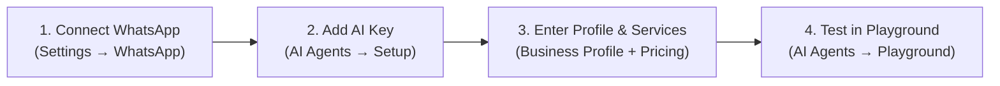

# WATTOMATION — OPERATOR QUICK-START GUIDE

> **Fast-Track 15-Minute Setup Guide for New Business Workspaces**
> **Platform Version:** 0.8.0

---

## 1. Quick Setup in 4 Steps

### Step 1: Connect Your WhatsApp Business Account (5 mins)
1. Go to **Settings** (`/settings`) from the left sidebar → click the **WhatsApp** tab.
2. Enter your **Phone Number ID**, **WABA ID**, and **Access Token** from your Meta Developer Portal.
3. Click **Save & Connect**.
4. Click **Verify Meta Registration & Webhooks** to confirm the connection is active with a green badge.

### Step 2: Configure Your AI Model (3 mins)
1. Go to **AI Agents** (`/agents`) from the left sidebar → click the **Setup** tab.
2. Select the **Provider & Models** sub-tab.
3. Choose your provider (**OpenAI**, **Anthropic Claude**, or **OpenAI-Compatible**).
4. Paste your API key (e.g. `sk-...`) and click **Test AI Connection**.
5. When verified, toggle **Enable AI Auto-Reply** to **ON** and click **Save AI Configuration**.

### Step 3: Enter Your Business Facts & Pricing (5 mins)
1. In **AI Agents** → **Setup** → **Business Profile**:
   - Enter your **Company Name**, **One-Line Value Proposition**, and **Contact Email**.
2. In the **Pricing & Rules** sub-tab:
   - Add your core services with descriptions and benefits.
   - Add your pricing packages (e.g. `$1,500 one-time` or `Custom quote`).
3. In the **Flow & Stages** sub-tab:
   - Ensure **Conversation Mode** is set to **AI Agent First (Recommended)**. This automatically prevents duplicate or contradictory greetings.

### Step 4: Test in the Playground (2 mins)
1. Go to **AI Agents** → **Playground** tab (`/agents?tab=playground`).
2. Type `hello` and test the greeting.
3. Provide a test name and email address. Verify that the agent captures both and advances to your service catalog.
4. Ask about pricing and verify that the agent quotes only your configured package prices.

---

## 2. Choosing the Right Tool for the Job

| I want to... | Use this tool | Navigation Path |
|---|---|---|
| Let AI handle customer questions and qualify leads dynamically | **AI Agent** | `/agents` → **Setup** |
| Build a button-based menu or structured survey | **Visual Flows** | `/flows` → **Create Flow** |
| Tag contacts automatically when they message | **Automations** | `/automations` → **Create Automation** |
| Send a mass WhatsApp announcement to existing customers | **Bulk Messages** | `/broadcasts` → **New Broadcast** |
| Schedule discovery calls with Google Calendar | **Meetings** | `/meetings` → **Settings** |
| Manage incoming messages and take over from the bot | **Messages** | `/inbox` |
| Track sales opportunities and deal sizes | **Pipelines** | `/pipelines` |

---

## 3. Important Rules of Thumb

1. **The Single-Conversation-Owner Rule:** Leave Conversation Mode on **AI Agent First**. Do not activate a static "Welcome Message" automation at the same time as the AI Agent unless you want the automation's text to be suppressed.
2. **The 24-Hour WhatsApp Window:** Free-form text can only be sent within 24 hours of a customer's message. To reach out after 24 hours, use an approved **Meta Message Template** in `/broadcasts` or `/settings?tab=templates`.
3. **Emergency Stop (Kill Switch):** If a bot ever sends incorrect replies, immediately assign the conversation to a team member in the **Messages Inbox** (`/inbox`), or toggle **Enable AI Auto-Reply** to **OFF** in `/agents?tab=setup`.

---

## 4. Where to Find More Help
- **Comprehensive Operations Manual:** [docs/manuals/WATTOMATION_COMPLETE_USER_MANUAL.md](file:///d:/Downloads/wacrmopsiys/wacrm/docs/manuals/WATTOMATION_COMPLETE_USER_MANUAL.md)
- **Technical Deployment & Hotfix Details:** [docs/manuals/WATTOMATION_AI_CONVERSATION_FIX_AND_DEPLOYMENT_MANUAL.md](file:///d:/Downloads/wacrmopsiys/wacrm/docs/manuals/WATTOMATION_AI_CONVERSATION_FIX_AND_DEPLOYMENT_MANUAL.md)
